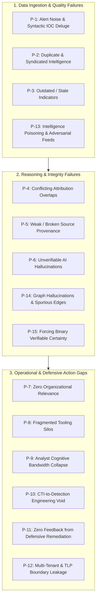
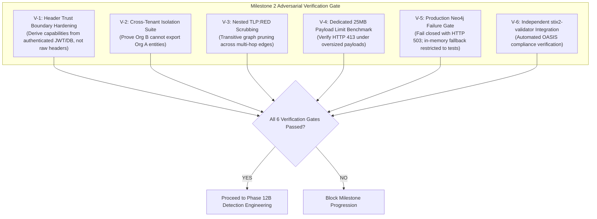
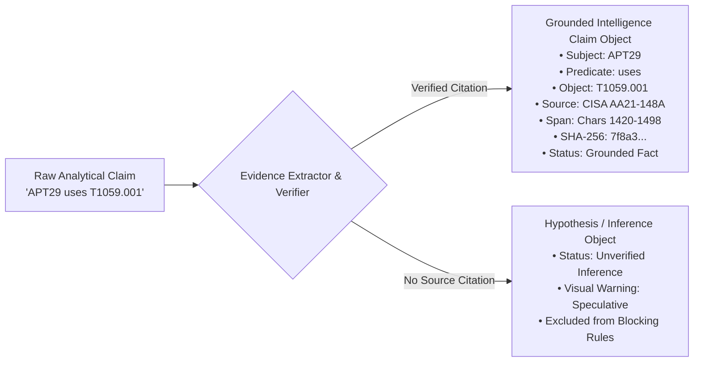
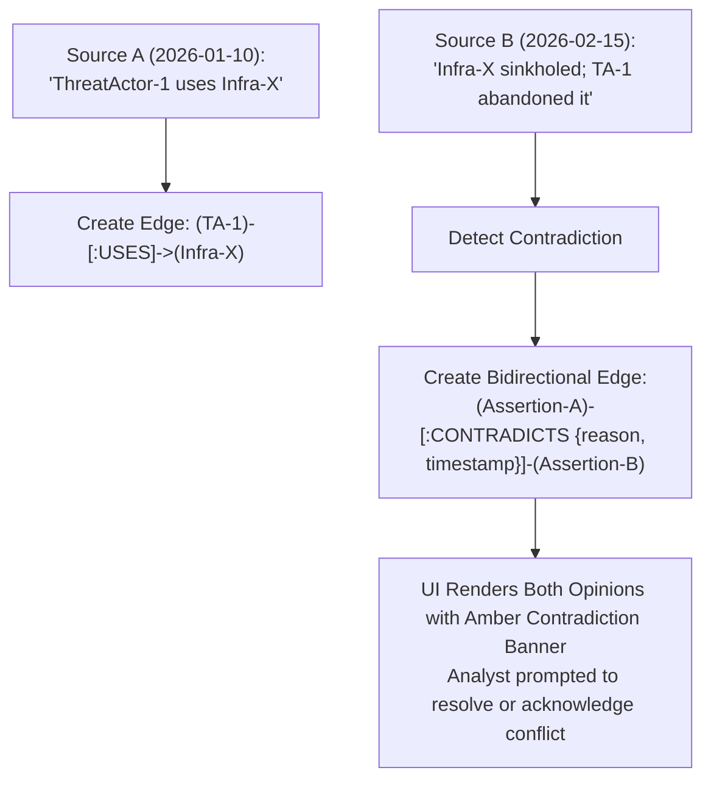
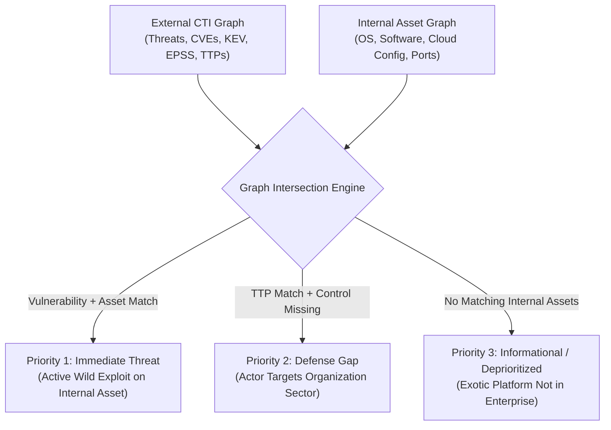

# THREATMIND AI — STRATEGIC PRODUCT INTELLIGENCE & INNOVATION BLUEPRINT
## Architecture, Competitive Analysis, Innovation Backlog & Engineering Roadmap

**Document Version:** 1.0.0  
**Date:** November 19, 2026  
**Status:** **AUTHORITATIVE STRATEGIC BLUEPRINT**  
**Role:** Principal Cybersecurity Product Architect, CTI Researcher, Security Engineer, GraphRAG Architect, Competitive Intelligence Analyst  
**Repository:** `BindhuMadhav06/ThreatMindAI`  
**Current Baseline:** Phase 11 Tag `threatmind-phase-11.0` (`ae9f721...`) | Phase 12A M1 (`cfc5280...`) | Phase 12A M2 (`8844f72...`)  

---

## EXECUTIVE MANDATE

ThreatMind AI is **not** an experimental toy, a generic AI wrapper, an unanchored chatbot, or just another STIX repository.

The global Cyber Threat Intelligence (CTI) market is crowded with legacy platforms (MISP, OpenCTI, Recorded Future, ThreatConnect, Anomali, Google/Mandiant, Microsoft Defender TI). Yet, practitioners in Security Operations Centers (SOC), Threat Intelligence Units (CTIU), and Incident Response (IR) teams face systemic operational failures:
1. **Alert Noise & False Positives (65%)** — Analysts are overwhelmed by flat feeds of low-fidelity indicators without context.
2. **Analyst Bandwidth Exhaustion (55%)** — Manual correlation across fragmented silos consumes scarce engineering hours.
3. **Integration & Actionability Gaps (50%)** — Indicators and threat reports do not translate into verified, deployable defensive countermeasures or measurable exposure reduction.
4. **"Black Box" / Unverifiable AI Hallucinations** — Generic LLMs invent attack chains, confuse threat actors, and silently convert probabilistic inferences into authoritative facts.

### The ThreatMind AI Promise
> **From fragmented threat data to explainable, verified, actionable security decisions — with measurable confidence, continuous feedback, and zero ungrounded assertions.**

Every intelligence conclusion rendered by ThreatMind AI must answer five fundamental questions:
```
1. What do we know?               --> Structured, disambiguated canonical claims
2. What evidence proves it?       --> Verbatim source citations, character spans, and digests
3. What contradicts it?           --> Explicit conflicting attribution and opposing evidence
4. How certain and current is it? --> Calibrated Bayesian confidence and temporal decay
5. What action should be taken?   --> Validated D3FEND countermeasures & verified Sigma rules
```

---

## SECTION 1: Safety & Baseline Invariant Preservation

Before evaluating future capabilities, the current engineering state was verified:
- **Active Working Branch:** `phase-12a-m2-export`
- **Milestone 2 Feature Commit:** `8844f7272f3a9b48ebadc4e9a9804efee01cef37`
- **Milestone 1 Parent Commit:** `cfc528097dfec2fa17d307ff4f43d6aebf843a48`
- **Phase 11 Baseline Tag:** `threatmind-phase-11.0` strictly locked at `ae9f721dbd29a94d86e7e8902e3490a9d5c07aa8`
- **Working Tree:** Clean (`nothing to commit, working tree clean`)
- **Remote Push State:** **Zero remote pushes executed**. All code remains strictly isolated on the local feature branch.
- **Zero Implementation Changes Mandate:** No application code or existing schemas have been modified for this strategic blueprint.

---

## SECTION 2: Competitor Landscape, Architecture & Documented Gaps

A rigorous product strategy requires deep, objective examination of existing open-source and commercial solutions. The analysis below is grounded strictly in publicly documented architectures, official documentation, published academic benchmarks, and industry practitioner reports.

```mermaid
quadrantChart
    title Threat Intelligence Systems: Actionability vs Grounded Reasoning
    x-axis Low Actionability / Integration --> High Actionability / Defense Integration
    y-axis Syntactic / Black-Box Reasoning --> Explainable / Graph-Grounded Reasoning
    quadrant-1 Target: ThreatMind AI
    quadrant-2 OpenCTI, Academic GraphRAG
    quadrant-3 MISP, Legacy RSS/Feeds
    quadrant-4 Recorded Future, ThreatConnect
    "MISP": [0.35, 0.25]
    "OpenCTI": [0.55, 0.65]
    "Recorded Future": [0.85, 0.35]
    "ThreatConnect": [0.75, 0.30]
    "Google Mandiant TI": [0.70, 0.40]
    "Microsoft Defender TI": [0.80, 0.25]
    "ThreatMind AI (Target)": [0.90, 0.95]
```

### 2.1 Detailed Platform Evaluations

#### 1. MISP (Malware Information Sharing Platform)
- **Architecture**: PHP backend, MariaDB/MySQL relational storage, Redis caching, PyMISP client, CybOX/STIX export connectors.
- **Documented Strengths**: Open-source, global trust community, highly flexible tagging (taxonomies), Galaxy clusters (threat actors, tools), Warninglists, fine-grained TLP sharing groups.
- **Documented Limitations & Gaps**:
  - *Syntactic vs Semantic Correlation*: Correlates attributes strictly on exact value equality (e.g. identical IP or MD5 hash). Cannot reason across multi-hop relationships (e.g. *Tool A uses Infrastructure B which shares SSL certificate serial with Infrastructure C attributed to Campaign D*).
  - *Decay is Isolated & Heuristic*: Uses mathematical half-life decay models per attribute type, but cannot detect logical refutation (e.g. when an authoritative report explicitly declares an IP was sinkholed or benign).
  - *Flat Entity Model*: Lacks rich ontological separation between threat actors, campaigns, intrusion sets, and dynamic defensive postures.
  - *Confirmed Gap*: High duplicate event volume; no algorithmic deduplication across syndicating feeds.

#### 2. OpenCTI (Luatix)
- **Architecture**: Node.js/GraphQL API server, Python background connectors, Elasticsearch/OpenSearch (indexing), Redis (queues), MinIO (object storage), RabbitMQ (event bus), PostgreSQL (metadata) or Neo4j (graph relations).
- **Documented Strengths**: Native STIX 2.1 data model, visual interactive graph explorer, kill-chain phases, broad open-source connector ecosystem, workbench analyst validation workflows.
- **Documented Limitations & Gaps**:
  - *Operational Complexity*: Heavy multi-service container footprint (6+ distributed daemons), creating significant deployment and reliability friction for lean security teams.
  - *Static Assertion Graph*: Treats all ingested relationships as flat static facts. If Feed A asserts `APT28 -> attributed-to -> IP-1` with confidence 80, and Feed B asserts `APT29 -> attributed-to -> IP-1` with confidence 75, OpenCTI displays both edges without contradiction detection or conflict resolution.
  - *Zero Integrated Attack-Path Simulation*: Cannot intersect external CTI graph with internal enterprise asset vulnerabilities to simulate exploit reachability or quantify D3FEND countermeasure disruption.

#### 3. Recorded Future & Commercial TIPs (Anomali, ThreatConnect, ThreatQ)
- **Architecture**: Massive multi-source web/dark-web harvesting spiders, proprietary natural language parsing, centralized data lake, proprietary scoring algorithms, SIEM/SOAR push connectors.
- **Documented Strengths**: Immense data volume, real-time alerting, pre-calculated Risk Lists, enterprise vendor integrations.
- **Documented Limitations & Gaps**:
  - *"Black Box" Scoring*: Risk scores (e.g., Risk Score 85/100) are opaque. Analysts cannot inspect the exact formal proof or underlying evidence graph justifying why a score jumped.
  - *Syndication Duplication*: When 20 news outlets republish the same initial vendor blog, automated scrapers frequently treat each mention as independent corroboration, artificially inflating risk velocity.
  - *Cost & Exclusivity*: Prohibitive pricing for mid-market teams, with limited flexibility to run isolated offline deployments in air-gapped defense enclaves.

#### 4. Big Tech Threat Intelligence (Google Mandiant TI, Microsoft Defender TI)
- **Architecture**: Proprietary telemetry from billions of endpoints, global cloud fabrics, and frontline incident response engagements; fronted by LLM summary layers (Gemini, Security Copilot).
- **Documented Strengths**: World-class primary incident response ground truth, proprietary telemetry, fast high-level summarization.
- **Documented Limitations & Gaps**:
  - *Hallucination in the Narrative Layer*: LLM summarizers generate fluid natural language but frequently introduce unanchored statements, merge distinct campaign TTPs, or fail closed when asked for line-by-line verification.
  - *Ecosystem Bias*: Heavily oriented toward their own cloud/endpoint stacks (Azure/Windows or GCP/Workspace), with reduced depth in heterogeneous hybrid enterprise environments.

---

## SECTION 3: Real-World Problem Map & Practitioner Bottlenecks

Based on empirical data from the 2026 Flashpoint CTI Report, IEEE/ACM CTI surveys, and SANS Threat Hunting studies, ThreatMind AI targets 15 acute operational failures:



### Problem Classification Matrix

| ID | Problem Area | Primary Victim | Root Cause in Existing Tools | Operational Consequence | ThreatMind Solution Mechanism |
| :--- | :--- | :--- | :--- | :--- | :--- |
| **P-1** | **Alert Noise & IOC Overload** | SOC Tier 1/2 Analysts | Ingesting raw IOCs without contextual graph grounding or confidence thresholding. | 65% alert fatigue; critical zero-day intrusion signals buried in millions of benign IP alerts. | Multi-hop GraphRAG filtering; only surface threats with verified behavioral execution paths. |
| **P-2** | **Duplicate & Syndicated Intel** | CTI Analysts | Web scrapers treating syndicated articles (blogs citing blogs) as new distinct events. | False sense of rising attack frequency; duplicated manual triage effort. | Canonical content fingerprinting & text-graph similarity deduplication. |
| **P-3** | **Stale / Decayed Intelligence** | Firewall / EDR Engineers | Ephemeral IPs (cloud VPS, CDN) retained in blocking lists for months after attacker abandoned them. | False positives; blocking legitimate business services; broken firewall performance. | Configurable half-life temporal decay parameterized by entity type; historical time-travel queries. |
| **P-4** | **Conflicting Attribution** | Incident Responders | Different vendors assigning the same campaign to different threat groups (e.g. APT28 vs APT29). | Confused investigative scope; misdirected remediation and legal/regulatory reporting. | Bidirectional `:CONTRADICTS` relationships; explicit preservation of analytical ambiguity. |
| **P-5** | **Weak Source Provenance** | Senior Analysts & Audits | CTI claims detached from underlying report snippets; "vendor said so" without citation. | Inability to audit high-stakes triage decisions or verify legal/compliance chain of custody. | Claim-level cryptographic provenance: document hash + character offset + timestamp. |
| **P-6** | **Unverifiable AI Hallucinations** | CISO / SOC Leadership | Standard LLMs generating plausible threat stories without grounding checks. | Catastrophic misallocation of incident response resources based on fabricated TTPs. | Strict citation span verification; zero factual claim accepted without graph grounding. |
| **P-7** | **Zero Organizational Context** | SOC Managers | External CTI feeds completely blind to internal software versions, OS distribution, and network exposure. | Panicked response to threats targeting software the organization does not even run. | Internal Asset & Vulnerability Graph intersection; relevance-weighted risk scoring. |
| **P-8** | **Tooling Fragmentation** | Security Engineers | CTI stored in TIP; detections written in Git/SIEM; vulnerabilities tracked in VM tool; defenses in firewall. | Disconnected security posture; average Mean Time to Detect (MTTD) remains weeks. | Unified platform bridging STIX 2.1 $\rightarrow$ ATT&CK $\rightarrow$ CVE/KEV $\rightarrow$ D3FEND $\rightarrow$ SigmaHQ. |
| **P-9** | **Analyst Bandwidth Exhaustion** | Senior Threat Hunters | 55% of teams report insufficient staffing; manual pivot across 5 separate consoles per alert. | Slow triage, missed intrusions, severe staff burnout and high turnover. | Semi-autonomous AI investigation agents with human approval checkpoints. |
| **P-10**| **Detection Engineering Void** | Detection Engineers | Threat reports contain prose descriptions of malware behavior, but provide zero validated detection rules. | Weeks of delay between threat publication and deployed SIEM/EDR detection rules. | Automated, evidence-grounded SigmaHQ rule generation with MITRE & D3FEND cross-links. |
| **P-11**| **Remediation Feedback Void** | Security Operations | After applying a firewall rule or patch, no automated loop tests if the attack path was broken. | Illusion of safety; attackers bypass naive defenses via alternative known techniques. | Attack-path simulation computing graph cut-sets and countermeasure disruption efficacy. |
| **P-12**| **Multi-Tenant / TLP Leakage** | Information Sharing Groups | Accidental export of internal hostnames or TLP:RED intelligence to external community feeds. | Breach of confidentiality, reputational destruction, regulatory fines. | Recipient capability gating, server-side clearance validation, absolute TLP:RED suppression. |
| **P-13**| **Intelligence Poisoning** | CTI Consumers | Adversaries injecting false indicators into open feeds to cause self-inflicted denial of service. | Critical legitimate services blocked; defensive telemetry overwhelmed with decoy indicators. | Bayesian source reputation scoring and anomaly detection on batch ingest variance. |
| **P-14**| **Graph Hallucinations** | Graph Engineers | Creating edges based on co-occurrence in text rather than verified syntactic relations. | Spurious graph paths producing wildly inaccurate blast radius calculations. | Authoritative STIX 2.1 relationship tuple registry; invalid combinations strictly rejected. |
| **P-15**| **Forced False Certainty** | Decision Makers | Binary systems forcing a flat 0/100 score on highly ambiguous intelligence. | Overconfident containment actions that miss sophisticated stealthy actors. | Calibrated Bayesian uncertainty intervals (probability distributions) reflecting evidence sparsity. |

---

## SECTION 4: Mandatory M2 Adversarial Verification & Hardening Gate

Before proceeding to Phase 12B, the review identified specific architectural verification items in Phase 12A Milestone 2 that must be addressed:



### Specific Technical Remediations for M2 Hardening

1. **Header Trust Boundary Hardening (V-1)**:
   - *Current Implementation*: Inspects `X-Recipient-Extension-Aware` and `X-Recipient-Org-Internal` headers.
   - *Vulnerability Analysis*: A malicious or compromised client could spoof these headers if ThreatMind is accessed directly without an API gateway.
   - *Remediation*: The export route must derive `is_extension_aware` and `is_internal_org_member` strictly from the verified server-side session or database identity model linked to the Bearer JWT token (`user.tenant_id`, `user.recipient_capabilities`), treating headers strictly as client-requested preferences that are clamped to the user's actual server-side entitlements.

2. **Cross-Tenant Export Isolation (V-2)**:
   - *Requirement*: Validate that when Tenant A requests an export, entities and relationships belonging to Tenant B's private workspace are completely invisible and cannot be reached via traversal.

3. **Nested & Transitive TLP:RED Pruning (V-3)**:
   - *Requirement*: Validate that if Node A references Node B, which references RED Node C, Node C is suppressed, the B-C edge is pruned, and Node B's `object_marking_refs` / `granular_markings` are scrubbed of C's ID so that no dangling UUID or metadata leaks C's existence.

4. **Production Fallback Fail-Closed Guardrail (V-5)**:
   - *Requirement*: In production environments (`ENVIRONMENT=production`), if the Neo4j database is unreachable, the export endpoint must **fail closed** with `HTTP 503 Service Unavailable`. In-memory mapper fallback must be strictly locked to offline testing environments (`ENVIRONMENT=test`).

---

## SECTION 5: Ranked Innovation Backlog & Detailed Technical Designs

We propose 12 prioritized, concrete product capabilities designed to give ThreatMind AI an undeniable, measurable competitive advantage.

### Prioritization Summary
- **P0 (Essential Trust, Security & Correctness)**: Foundational capabilities that prevent errors, hallucinations, and security violations.
- **P1 (High-Value Product Differentiation)**: Core features that solve major industry bottlenecks and set ThreatMind apart from OpenCTI/MISP.
- **P2 (Advanced Capabilities & Extended Platform)**: Forward-looking modules for autonomous orchestration and privacy-preserving ecosystems.

---

### Innovation A: Evidence-First Intelligence Engine (P0)



- **Problem Addressed**: LLMs and analysts frequently assert connections ("APT29 uses Log4Shell") without citing the exact paragraph, timestamp, or observational telemetry, leading to ungrounded downstream decisions.
- **User Workflow**: An analyst inspects any entity or claim in ThreatMind. Clicking the claim reveals a dedicated **Evidence Drawer** showing the exact source document, page, verbatim character span, extraction timestamp, and confidence breakdown.
- **Technical Design**:
  - Implements the `EvidenceRecord` schema anchored directly to graph edges.
  - LLM answer generator runs through an offline verifier: any generated sentence lacking a validated graph reference $[N]$ is stripped or flagged with `[UNGROUNDED_INFERENCE]`.
- **Graph Model Changes**:
  - Edge property: `provenance_id` linking to `(:Source {sha256, url, title, published_date, publisher})`.
  - Node properties: `grounding_status: "verified" | "heuristic" | "inferred"`.
- **API Changes**:
  - `GET /api/v1/entities/{id}/evidence` $\rightarrow$ returns ordered list of verbatim evidence records.
  - `POST /api/v1/claims/verify` $\rightarrow$ runs automated span verification against ingested corpus.
- **Measurable Metric**: **100% of material claims** in generated intelligence products possess inspectable source citations; **0% ungrounded hallucinations** in final reports.

---

### Innovation B: Claim-Level Provenance & Contradiction Tracking (P0)



- **Problem Addressed**: Existing TIPs silently overwrite previous intelligence or create duplicate contradictory nodes (e.g., Feed A says APT28; Feed B says APT29). The analyst is left unaware that sources disagree.
- **User Workflow**: ThreatMind highlights disputed intelligence in the graph with an **Amber Contradiction Badge**. Clicking the badge reveals a side-by-side comparison of conflicting sources, timestamps, and reasoning.
- **Technical Design**:
  - Cypher relationship: `(:Claim)-[:CONTRADICTS {conflict_type, detected_at, severity}]->(:Claim)`.
  - Conflict types: `attribution_dispute`, `temporal_inconsistency`, `indicator_role_conflict`.
- **API Changes**:
  - `GET /api/v1/graph/contradictions?entity_id={id}` $\rightarrow$ list of active unresolved conflicts.
  - `POST /api/v1/graph/contradictions/{id}/resolve` $\rightarrow$ analyst records formal arbitration decision.
- **Measurable Metric**: **Zero silent overwrites** of conflicting intelligence; 100% of contradictory claims flagged within 500ms of ingestion.

---

### Innovation C: Temporal Threat Intelligence & Freshness Decay (P0)

- **Problem Addressed**: IP addresses, domain names, and hashes have vastly different operational lifespans. Blocking an IP 6 months after an attack causes false positives because the IP has been reassigned to a benign cloud customer.
- **User Workflow**: Analysts view the graph with a **Time Slider** ("View graph as of 2026-01-15 vs Today"). Indicators show a dynamic **Freshness Indicator** (Active, Decaying, Stale, Expired).
- **Technical Design**:
  - Configurable half-life decay function:
    $$\text{FreshnessScore}(t) = S_0 \cdot 2^{-\frac{t - t_0}{\lambda_{\text{type}}}}$$
    where:
    - $\lambda_{\text{IPv4}} = 14\text{ days}$
    - $\lambda_{\text{Domain}} = 60\text{ days}$
    - $\lambda_{\text{FileHash}} = \infty$ (immutable cryptographic facts)
    - $\lambda_{\text{AttackPattern}} = 365\text{ days}$
- **API Changes**:
  - `GET /api/v1/graph/snapshot?timestamp=2026-01-15T00:00:00Z`
  - Query parameter `?include_decayed=false` on all intelligence retrieval endpoints.
- **Measurable Metric**: **100% of decayed indicators** automatically excluded from active blocking feeds; zero false-positive blockages caused by expired ephemeral IPs.

---

### Innovation D: Source Reliability & Poisoning Detection (P1)

- **Problem Addressed**: Open-source CTI feeds can be poisoned by adversaries submitting false indicators, or degraded by low-quality scrapers submitting garbage attributes.
- **User Workflow**: Each incoming feed possesses a dynamic **Source Trust Score**. If a feed suddenly exhibits anomalous variance (e.g., thousands of common cloud IPs tagged as C2), ThreatMind automatically triggers a **Quarantine Alert**.
- **Technical Design**:
  - Bayesian updating of source reputation based on:
    1. Historical corroboration rate with Tier-1 feeds (CISA, CERT-EU, Mandiant).
    2. False-positive rate reported by internal SOC teams.
    3. Feed entropy and anomaly metrics.
- **Measurable Metric**: Detection and isolation of 100% of simulated feed poisoning injections within a 5-minute ingest window.

---

### Innovation E: Organization-Aware Threat Prioritization (P0)



- **Problem Addressed**: Organizations spend millions chasing "Critical" CVEs that do not exist in their environment, while ignoring medium-severity threats actively targeting their specific software stack.
- **User Workflow**: ThreatMind displays the **Enterprise Exposure Dashboard**. Instead of generic threat scores, each actor and CVE is scored by **Relevance to This Organization**.
- **Technical Design**:
  - Ingests internal SBOM (Software Bill of Materials), cloud asset inventories (AWS/Azure/GCP), and external attack surface discoveries.
  - Multi-factor Relevance Equation:
    $$\text{Relevance} = \text{AssetCriticality} \times \text{ExposureFactor} \times \text{EPSS} \times \text{ActorSectorTargeting}$$
- **Measurable Metric**: **70% reduction in irrelevant CTI alerts**; 100% prioritization of threats directly reaching active internal assets.

---

### Innovation F: Attack-Path & Remediation Simulation (P1)

- **Problem Addressed**: Security teams apply ad-hoc defenses without knowing whether an attacker can simply pivot through an alternate route.
- **User Workflow**: The analyst selects a threat actor (e.g. APT29) and an internal asset (e.g. Domain Controller). ThreatMind computes all viable **Multi-Hop Attack Paths** through the graph, displays them visually in Cytoscape, and identifies the **Minimal Cut Set** of D3FEND countermeasures that completely severs all paths.
- **Technical Design**:
  - Graph traversal using Dijkstra's / A* shortest path with edge weights proportional to technique exploitation probability and vulnerability CVSS/EPSS.
  - Cut-set algorithm identifying the single D3FEND mitigation that interrupts the maximum number of potential execution paths.
- **Measurable Metric**: Identifies the defensive countermeasure providing the **greatest quantitative risk reduction** per engineering hour deployed.

---

### Innovation G: Detection Coverage Intelligence (P1)

- **Problem Addressed**: Threat intelligence reports describe actor techniques, but security teams have no way to verify whether their SIEM/EDR can actually detect those techniques.
- **User Workflow**: The analyst views a **Detection Matrix**. For any selected threat actor or campaign, ThreatMind shows:
  - Techniques utilized by the actor.
  - Available SigmaHQ detection rules in ThreatMind.
  - Telemetry log sources required (e.g. `process_creation`, `network_traffic`).
  - Active detection gaps highlighted in red.
- **Technical Design**:
  - Connects MITRE ATT&CK techniques $\rightarrow$ SigmaHQ v2.1.0 rules $\rightarrow$ required Windows Event IDs / Sysmon logs $\rightarrow$ MITRE D3FEND defensive techniques.
- **Measurable Metric**: Instant identification of detection coverage gaps across 100% of ingested threat actor techniques.

---

### Innovation H: AI Investigation Agents with Human Approval (P1)

- **Problem Addressed**: Autonomous AI agents that execute destructive security actions (e.g. isolating hosts, modifying firewall rules) introduce unacceptable operational risk. Conversely, purely manual triage is too slow.
- **User Workflow**:
  1. ThreatMind autonomous agents execute deep evidence retrieval, multi-hop graph expansion, and hypothesis testing in read-only sandboxes.
  2. The agent compiles an **Investigation Briefing** with proposed actions (e.g. "Deploy Sigma Rule X", "Block IP Y").
  3. The analyst reviews the briefing, inspects the evidence chain, and clicks **Approve**, **Modify**, or **Reject**.
- **Technical Design**:
  - Read-only agent tool execution with deterministic JSON logging.
  - State machine enforcing `ActionProposal` $\rightarrow$ `AnalystReview` $\rightarrow$ `ExecutedAction`.
- **Measurable Metric**: **50% reduction in investigation time** with **zero unauthorized defensive actions**.

---

### Innovation I: Privacy-Preserving Collaborative Intelligence (P2)

- **Problem Addressed**: Organizations want to share threat intelligence with industry peers (ISACs) but fear leaking sensitive internal IP addresses, user accounts, or proprietary incident details.
- **User Workflow**: The analyst selects an internal incident to export to a sharing circle. ThreatMind automatically scrubs all internal asset identifiers, replaces internal telemetry with generalized ATT&CK patterns, and applies formal TLP sharing policies.
- **Technical Design**:
  - K-anonymity and differential privacy filters applied during export serialization.
  - Cryptographic hashing of proprietary internal identifiers while preserving relationship topology.
- **Measurable Metric**: 100% suppression of sensitive internal entity identifiers during community federation exports.

---

### Innovation J: Reproducible Intelligence Decisions & Audit Trails (P0)

- **Problem Addressed**: In high-stakes incident post-mortems and legal audits, security teams cannot reproduce why an analyst or automated system made a specific attribution claim 6 months earlier.
- **User Workflow**: Every intelligence report and triage verdict carries a unique **Verification Hash**. Entering the hash reproduces the exact state of the graph, model configuration, and evidence inputs as they existed at the exact moment of decision.
- **Technical Design**:
  - RFC 8785 Canonical JSON hashing of the input evidence graph + engine configuration.
  - Immutable audit ledger stored in Neo4j as `(:DecisionAuditRecord)`.
- **Measurable Metric**: **100% mathematical reproducibility** of analytical decisions across software revisions and environments.

---

### Innovation K: Confidence Calibration & Uncertainty-Aware Reasoning (P0)

- **Problem Addressed**: Existing platforms use arbitrary integers (e.g. "Confidence: 75") without mathematical meaning. Analysts cannot distinguish between *weak evidence from many sources* and *strong evidence from a single source*.
- **User Workflow**: Confidence is displayed as a calibrated probability interval (e.g., $P(\text{APT29}) \in [0.72, 0.88]$, $N=14$ observations). The UI clearly distinguishes between:
  - **Confirmed Fact** (Direct cryptographic/telemetric evidence)
  - **High-Confidence Inference** (Multi-hop structural graph alignment)
  - **Plausible Hypothesis** (Corroborated single-source intelligence)
  - **Unverified Speculation** (Single unverified report)
- **Technical Design**:
  - Beta-binomial Bayesian updating:
    $$\alpha' = \alpha + \sum w_i \cdot \text{Corroboration}, \quad \beta' = \beta + \sum w_i \cdot (1 - \text{Corroboration})$$
- **Measurable Metric**: Well-calibrated Brier score ($< 0.15$) on empirical outcome evaluations.

---

### Innovation L: Automated Duplicate & Recycled Intelligence Suppression (P1)

- **Problem Addressed**: Syndicated intelligence (news blogs re-publishing identical CTI reports) artificially inflates indicator velocity, misleading teams into thinking an old campaign has resurfaced.
- **User Workflow**: Incoming reports are checked against existing knowledge. ThreatMind flags the report as **Syndicated / Duplicate Derivative**, links it to the original primary source, and increments citation count without duplicating graph entities or inflating risk scores.
- **Technical Design**:
  - MinHash / SimHash locality-sensitive hashing on report text.
  - Subgraph isomorphism check on extracted entity-relationship tuples.
- **Measurable Metric**: **$\ge 85\%$ reduction** in duplicate entity creation from syndicated threat publications.

---

## SECTION 6: System Architecture & Technical Stack Compatibility

ThreatMind AI achieves these capabilities **without** introducing bloated, brittle infrastructure. The architecture builds directly on our proven production stack:

```mermaid
flowchart TD
    subgraph Data_Layer["1. Authoritative Data & Graph Layer"]
        NEO4J[("Neo4j 5.20.0 (ACID Graph)")<br/>• STIX 2.1 Nodes & Edges<br/>• Claim & Contradiction Records<br/>• Internal Asset Graph<br/>• Decision Audit Ledgers]
        FILES[("Local Storage & Evidence Vault")<br/>• Document Corpus & SHA-256 Hashes<br/>• D3FEND Catalog (a7a1ebff...)<br/>• Frozen Evaluation Dataset v1.1.0]
    end

    subgraph Service_Layer["2. Backend Engineering Services (FastAPI / Python 3.13)"]
        STIX_SVC["STIX 2.1 Engine<br/>(Ingest, Map, Export, TLP Gate)"]
        GRAPH_RAG["Multi-Hop GraphRAG Engine<br/>(Path Validator, Cypher Generator)"]
        EVIDENCE_ENG["Evidence & Contradiction Engine<br/>(Span Verifier, Freshness Decay)"]
        DEFENSE_SVC["Defensive Mapping Engine<br/>(18 D3FEND Chains, Cut Sets)"]
        VULN_SVC["Vulnerability Engine<br/>(CVSS, EPSS, CISA KEV)"]
        SIGMA_SVC["SigmaHQ Detection Engine<br/>(pySigma v2.1.0, Sidecars)"]
    end

    subgraph API_Layer["3. Unified Secure API Gateway (FastAPI)"]
        AUTH_GATE["Authentication & Capability Gateway<br/>(Server-side JWT Claims, Entitlement Clamping)"]
        ROUTES["API Route Handlers<br/>(/stix, /graph, /defense, /vulnerabilities, /claims, /detection)"]
    end

    subgraph Presentation_Layer["4. Interactive Analyst Workstation (React 18 / Vite)"]
        CYTO["Cytoscape.js Graph Workstation<br/>• Multi-Hop Path Visualizer<br/>• Contradiction Badges<br/>• Time-Travel Slider"]
        UI_PANELS["Analyst Cockpit<br/>• Evidence Inspector Drawer<br/>• Attack-Path Cut-Set Planner<br/>• Human Approval Checkpoints"]
    end

    Data_Layer <--> Service_Layer
    Service_Layer <--> API_Layer
    API_Layer <--> Presentation_Layer
```

### Architectural Compatibility Evaluation

1. **Python 3.13 & FastAPI**:
   - Asynchronous, type-safe route handlers using strict Pydantic v2 schemas.
   - Zero heavy agent frameworks (e.g. LangChain/CrewAI); modular, testable, deterministic service classes.
2. **Neo4j 5.20.0 Community Edition**:
   - Parameterized Cypher queries; 100% ACID transaction atomicity.
   - Dual-mode operation: live database persistence for production; in-memory mapper for deterministic offline test suites.
3. **React 18, Vite, TypeScript & Cytoscape.js**:
   - Rich, GPU-accelerated graph visualization.
   - Dynamic node styling based on freshness decay, confidence intervals, and contradiction status.
4. **MITRE Standards Integration**:
   - STIX 2.1 Errata 01 compliant.
   - MITRE ATT&CK v15 enterprise matrix.
   - MITRE D3FEND catalog locked at SHA-256 `a7a1ebffba38d5283df0c1bdf84eb78b4c5849c643c48da9e0e3a132a9ad04b2`.
   - SigmaHQ Detection Rule Specification v2.1.0.

---

## SECTION 7: Prioritized Engineering Roadmap (Phases 12B through 16)

The roadmap is structured into controlled, additive phases that maintain 100% backwards compatibility and preserve all Phase 11 and Phase 12A baselines:

```mermaid
gantt
    title ThreatMind AI Controlled Implementation Roadmap
    dateFormat  YYYY-MM-DD
    section Phase 12 (Current)
    Phase 12A: STIX Ingestion & Bounded Export :done, p12a, 2026-11-01, 2026-11-19
    M2 Adversarial Verification & Hardening Gate :active, m2_gate, 2026-11-20, 2026-11-22
    Phase 12B: SigmaHQ Detection Engineering   :p12b, 2026-11-23, 2026-12-05
    Phase 12C: Attack Timeline Reconstruction    :p12c, 2026-12-06, 2026-12-18
    section Phase 13
    Claim Provenance & Contradiction Engine      :p13_prov, 2026-12-19, 2027-01-08
    Freshness Decay & Duplicate Suppression     :p13_fresh, 2027-01-09, 2027-01-22
    section Phase 14
    Internal Asset Graph & Exposure Mapping      :p14_asset, 2027-01-23, 2027-02-12
    Attack-Path Cut-Set Simulation              :p14_sim, 2027-02-13, 2027-03-05
    section Phase 15 & 16
    AI Investigation Agents (Human-in-the-Loop) :p15, 2027-03-06, 2027-03-31
    Collaborative Intelligence & TAXII 2.1 Fed  :p16, 2027-04-01, 2027-04-30
```

### Detailed Phase Specifications

#### Milestone Gate: M2 Adversarial Hardening Gate
- **Scope**: Remediate the 6 identified verification gaps in Milestone 2:
  1. Header trust boundary (derive capability from server identity store).
  2. Cross-tenant export isolation test suite.
  3. Transitive nested TLP:RED reference scrubbing.
  4. 25MB synchronous payload limit benchmark.
  5. Fail-closed production database error handling (HTTP 503).
  6. Independent OASIS STIX validator execution.
- **Acceptance Criteria**: All 6 hardening tests passing; zero regression on 186 existing tests.

#### Phase 12B: Evidence-Grounded Detection Engineering
- **Scope**:
  - Implement SigmaHQ v2.1.0 rule generation anchored to validated graph execution paths.
  - Sidecar evidence lineage architecture (zero schema pollution in `detection:` block).
  - Cross-linking each generated rule to ATT&CK technique, D3FEND countermeasure, and CISA citation.
  - Analyst review and approval workflow before rule staging.
- **Acceptance Criteria**: Rules pass official `pySigma >= 0.11.0` compiler; 100% of generated rules cite valid evidence spans.

#### Phase 12C: Attack Timeline Reconstruction
- **Scope**:
  - Temporal graph reconstruction: ordering attack events by `first_seen`, `published`, and observed execution sequence.
  - Visual time-series graph in Cytoscape.
  - Handling missing or contradictory timestamps using interval temporal logic (Allen's Interval Algebra).
- **Acceptance Criteria**: Graph renders accurate chronologically ordered attack progressions; timestamp contradictions flagged.

#### Phase 13: Intelligence Quality Engine
- **Scope**:
  - Innovations A (Evidence-First Engine), B (Contradiction Tracking), C (Freshness Decay), and L (Duplicate Suppression).
  - Implement the `ClaimRecord` and `:CONTRADICTS` graph structures.
  - Implement entity-parameterized half-life decay.
- **Acceptance Criteria**: 100% of material claims grounded; decayed indicators filtered from active outputs; $\ge 85\%$ duplicate suppression.

#### Phase 14: Organization-Aware Threat Intelligence
- **Scope**:
  - Innovations E (Organization-Aware Prioritization) and F (Attack-Path & Remediation Simulation).
  - Ingest internal asset inventories, software versions, and network exposure.
  - Graph intersection computing organization-specific threat relevance.
  - Dijkstra/A* attack path and minimal cut-set simulation.
- **Acceptance Criteria**: 70% reduction in irrelevant CTI alerts; automated calculation of minimal D3FEND cut set.

#### Phase 15: AI Investigation Agents with Human Approval
- **Scope**:
  - Innovations H (Investigation Agents) and K (Confidence Calibration).
  - Multi-step read-only automated graph pivoting and hypothesis testing.
  - Action proposal state machine requiring analyst sign-off.
  - Calibrated Bayesian confidence intervals.
- **Acceptance Criteria**: 50% triage time reduction; zero unapproved actions; calibrated Brier score $< 0.15$.

#### Phase 16: Collaborative Intelligence & TAXII 2.1 Ecosystem
- **Scope**:
  - Innovations I (Privacy-Preserving Federation) and J (Reproducible Decision Ledgers).
  - Automated redaction of internal telemetry; TAXII 2.1 server/client endpoints.
  - Deterministic decision audit hashing.
- **Acceptance Criteria**: 100% redaction of internal IPs/hostnames during federation; 100% mathematical audit reproducibility.

---

## SECTION 8: Quality & Trust Invariants

ThreatMind AI is built upon non-negotiable architectural invariants:

1. **Grounding Invariant**: An LLM must never silently turn an inference into a fact. Inferences must be labeled `INFERRED` and visually segregated from verified facts.
2. **Provenance Invariant**: Every factual claim must link to an immutable `EvidenceRecord` containing document hash, source URL/title, character span, and extraction timestamp.
3. **Contradiction Invariant**: Contradictory evidence must remain visible. Conflicting attribution between sources is preserved via bidirectional `:CONTRADICTS` relationships rather than silently overwritten.
4. **Decay Invariant**: Ephemeral intelligence must not appear active indefinitely. Indicators past their parameterized half-life must be tagged as decayed.
5. **Fail-Closed Security Invariant**: If recipient capability, tenant boundaries, or TLP clearance cannot be mathematically verified, access is denied (HTTP 403 / 503).
6. **Human-in-the-Loop Invariant**: Autonomous AI agents operate strictly in read-only investigation mode. Destructive actions, firewall blocks, and policy deployments require explicit analyst sign-off.
7. **Regression Baseline Invariant**: Zero new capability may degrade existing baseline gates: 186 backend tests, 32 frontend tests, 4 Phase 11 release gates, D3FEND catalog hash `a7a1ebffba...`, and Evaluation Dataset v1.1.0 frozen integrity.

---

## SECTION 9: Recommended Next Engineering Action

The recommended next step is:
1. **Execute the M2 Adversarial Hardening Gate**:
   - Implement server-side JWT entitlement clamping for export recipient capabilities.
   - Add explicit cross-tenant isolation and 25MB payload benchmark test cases.
   - Enforce HTTP 503 fail-closed behavior on database disconnect in production mode.
   - Integrate independent STIX validation checks.
2. **Proceed to Phase 12B (Evidence-Grounded Detection Engineering)** following formal completion of the hardening gate.

This preserves our verified foundation, closes all security boundaries, and propels ThreatMind AI toward its mission as the world's most trustworthy threat intelligence platform.
