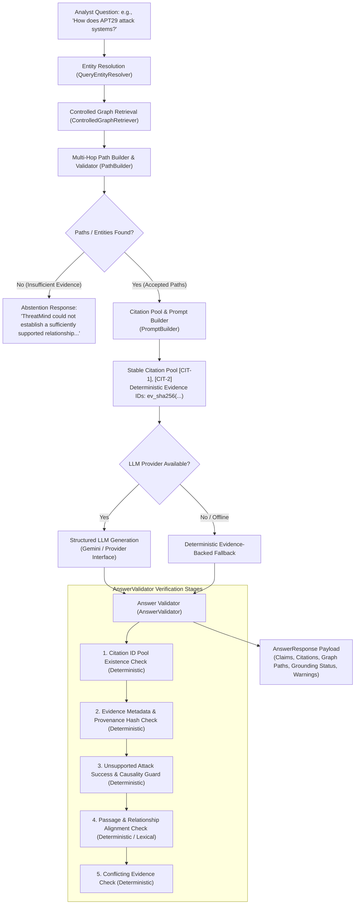

# ThreatMind: Evidence-Grounded Answer Generation & Claim Validation

## 1. Executive Summary & Core Principle

ThreatMind implements an evidence-grounded question-answering architecture that synthesizes multi-hop cybersecurity knowledge graph traversals into transparent, citation-backed natural-language answers.

The system is governed by a strict operational principle:
> **"No guessing. No invented relationships. Every substantive cybersecurity claim must be traceable to retrieved evidence."**

ThreatMind does not treat LLM generation as inherently truthful. Instead, it places the LLM inside a deterministic sandwich:
1. **Pre-generation Bounding**: GraphRAG retrieval and path validation constrain the LLM's inputs strictly to verified graph edges and verbatim evidence quotes.
2. **Post-generation Multi-Stage Verification**: An independent validation engine verifies citation references, checks passage alignment, detects unsupported attack-success or causality claims, and flags or isolates unverified assertions.

---

## 2. Architecture & Generation Pipeline

---

## 3. Separation of Citation Integrity from Semantic Grounding

In ThreatMind, a claim is **not** considered factually supported merely because it attaches a syntactically valid citation ID like `[CIT-1]`. Citation integrity and semantic grounding are evaluated through separate validation checks:

| Validation Stage | Methodology | Check Type | What It Enforces / Catches |
| :--- | :--- | :--- | :--- |
| **Citation ID Integrity** | Pool Membership | **Deterministic** | Verifies `citation_id` exists in the active response citation pool. Rejects hallucinated tags like `[CIT-999]`. |
| **Evidence Metadata Integrity** | Identifier & Source Verification | **Deterministic** | Verifies `evidence_id` follows the stable format `ev_<sha256(src|rel|text)[:12]>` and references an authenticated source ID. |
| **Attack Success & Causality Guard** | Pattern Matching & Evidence Verification | **Deterministic** | Detects aggressive compromise keywords (*"successfully breached"*, *"destroyed"*, *"full takeover"*, *"compromised the network"*). Marks claim unverified if cited passage only documents capability/usage without confirmed outcome. |
| **Passage & Relationship Alignment** | Token Overlap & Entity Intersections | **Deterministic / Lexical** | Computes substantive token overlap between `claim_text` and the cited passage (`evidence_text` + `supported_relationship`). Requires $\ge 2$ shared key terms or $\ge 25\%$ token overlap. |
| **Conflicting Evidence Preservation** | Discrepancy Tracking | **Deterministic** | Ensures contradictory source statements (e.g. conflicting dates or targets) are not silently unified into a single false consensus. |

### Grounding Statuses
The validation engine assigns one of four grounding statuses:
- **`fully_grounded`**: All proposed claims passed all validation checks against retrieved evidence.
- **`partially_grounded`**: At least one claim is verified, but one or more claims failed validation or partial paths were utilized.
- **`insufficient_evidence`**: Abstention triggered due to absence of resolvable graph entities or absence of supporting paths.
- **`unsupported`**: All proposed claims failed validation checks.

> [!NOTE]
> Grounding status reflects the computational verification checks performed by ThreatMind. It describes consistency between the generated text and the retrieved knowledge graph records; it does not constitute philosophical proof that an external cyber event occurred in the physical world.

---

## 4. Abstention Policy

When an analyst's question cannot be grounded in existing knowledge graph evidence, ThreatMind explicitly refuses to extrapolate or hallucinate.

### Standard Abstention Response
If no query entities can be resolved, or if graph traversal yields zero valid multi-hop paths or evidence records, ThreatMind returns the exact phrase:
> **"ThreatMind could not establish a sufficiently supported relationship from the currently available sources."**

- `grounding_status`: `"insufficient_evidence"`
- `sufficiency_status`: `"insufficient"`
- `claims`: `[]`
- `citations`: `[]`
- `referenced_paths`: `[]`

---

## 5. Provenance & Deterministic Evidence IDs

To avoid fragility from transient Neo4j internal node or relationship IDs, ThreatMind generates stable, deterministic evidence identifiers:

$$\text{evidence\_id} = \text{"ev\_"} + \text{SHA256}(\text{source\_id} \parallel \text{relationship} \parallel \text{evidence\_text})[:12]$$

### Safeguards:
1. **Zero Fabricated Metadata**: If source metadata (e.g., publication date, publisher, URL, or author) is missing in the ingested document, it remains `None` / empty. ThreatMind never fabricates publication dates or author names.
2. **Missing Confidence Handling**: If extraction confidence is missing, it is treated as `None` (unknown). It is neither assumed to be 0.0 nor 1.0. Confidence thresholds (`min_confidence`) do not silently drop records whose confidence is unknown unless explicitly filtered.

---

## 6. Synthetic Data Limitations & Transparency

The test fixture (`data/sample/demo_synthetic_cti.json`) contains synthetic data constructed specifically for software verification and traversal testing.

### Verified Fixture Graph Paths
The actual paths present in the synthetic fixture and Neo4j database are:
- **Technique Execution Chain**:
  `APT29 -[USES]-> Cobalt Strike -[USES_TECHNIQUE]-> PowerShell -[PART_OF]-> Execution`
- **Vulnerability Impact Chain**:
  `APT29 -[EXPLOITS]-> CVE-2021-44228 -[AFFECTS]-> Apache Log4j`
- **Targeting Link**:
  `APT29 -[TARGETS]-> Government Sector`
- **Tool Link**:
  `APT29 -[USES]-> Mimikatz`

### Transparency Guard:
- When evidence derives from synthetic demo files, every citation carries `is_synthetic: true`.
- The overall answer is marked `is_synthetic: true`.
- A mandatory warning is attached:
  > *"SYNTHETIC DATA NOTICE: Response is grounded in synthetic demonstration data, not verified real-world threat intelligence."*
- Responses grounded in synthetic data must never be presented as proof of real-world threat actor activity.

---

## 7. Deterministic Offline Fallback

In offline test environments or when LLM API keys are unconfigured, `AnswerGenerator` does not crash or produce empty responses. Instead, it activates a deterministic fallback generator:
1. Synthesizes declarative statements directly from the validated `EvidenceBackedPath` steps.
2. Injects exact citation tags `[CIT-X]` referencing the deterministic evidence IDs.
3. Passes the synthesized claims through the exact same `AnswerValidator`.
4. Abstains with the standard abstention phrase when evidence is missing.

This ensures 100% reproducible test execution and development without external API dependencies.

---

## 8. Verification & Test Suite Summary

Phase 7 implementation is verified by 17 dedicated tests across four test suites, bringing the total passing backend test count to **77 tests**:

| Test Suite | Tests | Scope Covered |
| :--- | :---: | :--- |
| `test_prompt_builder.py` | 3 | Citation pool construction, deterministic `ev_` IDs, anti-hallucination instructions, schema generation. |
| `test_answer_validator.py` | 6 | Supported claims, fabricated citation rejection (`CIT-999`), unsupported attack success detection, semantic misalignment, metadata integrity failure, status computation (`fully_grounded`, `partially_grounded`, `insufficient_evidence`). |
| `test_answer_generator.py` | 4 | End-to-end generation with Mock LLM, deterministic offline fallback, unknown entity abstention, adversarial presupposition rejection. |
| `test_api_answer.py` | 4 | `POST /api/v1/query/answer` HTTP 200, HTTP 400 on empty question, HTTP 422 on depth violation, HTTP 200 abstention payload. |

All 77 backend tests pass cleanly with zero failures.

---

## 9. Known Weaknesses & Planned Future Evaluations

1. **Empirical Grounding Benchmarks**: Formal hallucination rates and claim precision/recall have not yet been evaluated on an empirical benchmark dataset (e.g., full MITRE ATT&CK CTI reports). Metrics are currently planned rather than claimed as finalized empirical numbers.
2. **Lexical Alignment vs Complex Paraphrasing**: The deterministic lexical overlap check ($\ge 2$ substantive tokens or $\ge 25\%$ overlap) is robust against fabricated citations, but highly creative LLM paraphrases with zero vocabulary overlap may be flagged as unverified. Semantic embedding-based similarity validation is planned for future phases.
3. **Implicit Temporal Ordering**: Traversal paths document observed relationships but do not verify chronological sequences (e.g., whether tool usage preceded vulnerability exploitation) unless explicit temporal timestamps exist on relationships.
