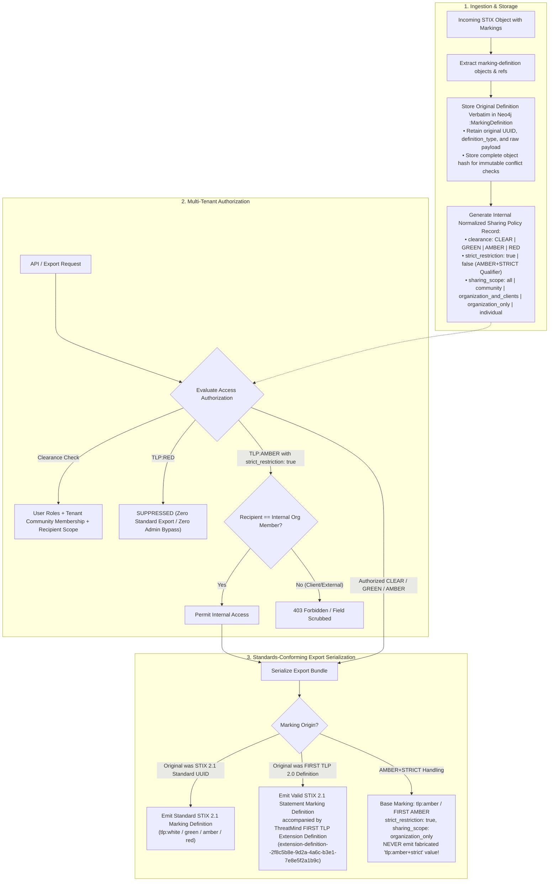
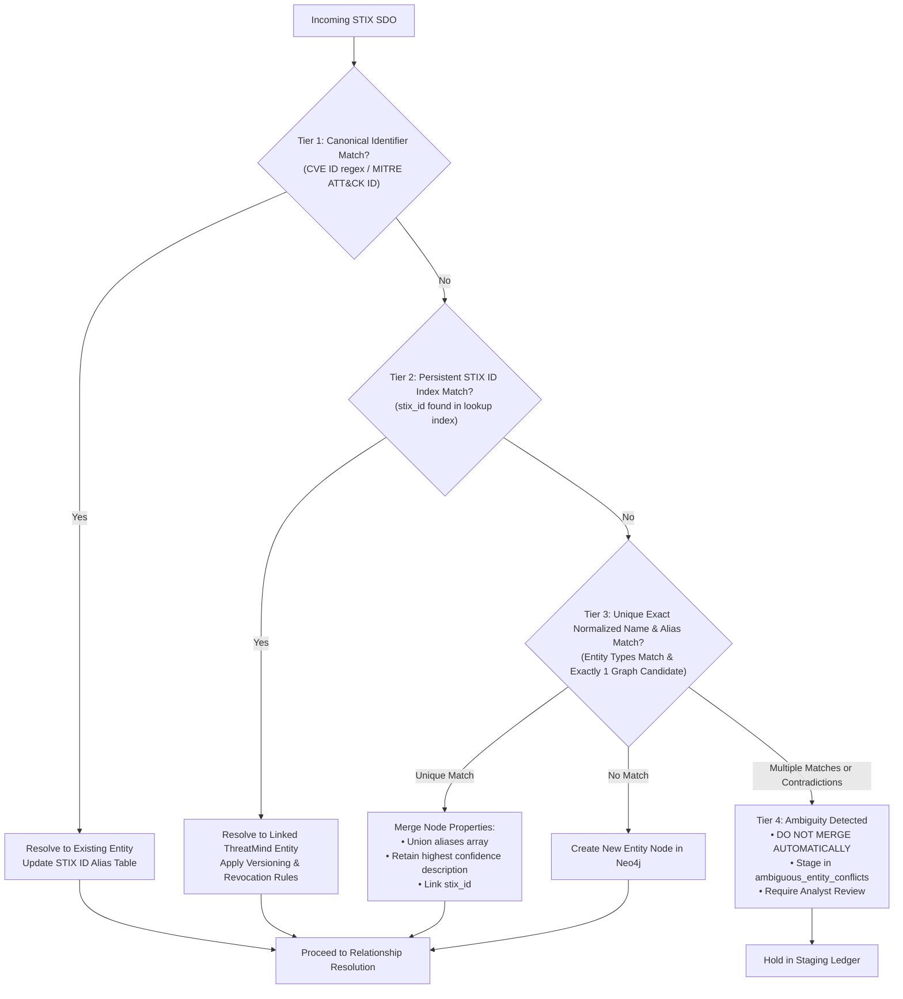
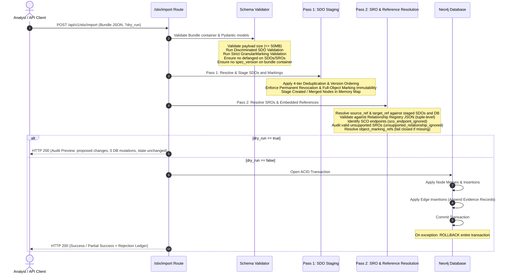

# ThreatMind AI — Phase 12 Architecture & Acceptance Criteria
## STIX 2.1 Interoperability, Evidence-Grounded Detection Engineering, and Chronological Attack Reconstruction

**Document Version**: 2.1.4  
**Status**: APPROVED IN PRINCIPLE — FINAL REVISED ARCHITECTURAL SPECIFICATION  
**Author**: Principal Software Architect, STIX 2.1 Interoperability Engineer, Neo4j Database Architect & Security Reviewer  
**Prerequisite Milestone**: Phase 11.0 (Locked at Git tag `threatmind-phase-11.0`)  
**Pinned Dependencies**:
- **Pydantic**: `pydantic>=2.6.0` (Active Environment: `2.13.5`)
- **Pydantic Settings**: `pydantic-settings>=2.2.0`
**Core Reference Standards**:
- [OASIS STIX™ Version 2.1 Errata 01 Specification](https://docs.oasis-open.org/cti/stix/v2.1/stix-v2.1.html)
- [FIRST Traffic Light Protocol (TLP) Version 2.0](https://www.first.org/tlp/)
- [CVE Record Format JSON Schema](https://github.com/CVEProject/cve-schema/blob/main/schema/CVE_Record_Format.json)
- [Sigma HQ Detection Specification v2.1.0](https://github.com/SigmaHQ/sigma-specification)
- [RFC 8785: JSON Canonicalization Scheme (JCS)](https://datatracker.ietf.org/doc/html/rfc8785)

---

## Executive Summary & Phased Implementation Roadmap

Phase 11.0 established ThreatMind's operational defense capabilities through authoritative **MITRE D3FEND™ defensive recommendations** and **freshness-aware vulnerability intelligence** (CVSS v3.1, EPSS 30-day wild exploit probability, CISA KEV catalog tracking).

Phase 12 expands ThreatMind into an interoperable Cyber Threat Intelligence (CTI) and Detection Engineering platform. To prevent feature expansion from weakening ThreatMind's foundational strength—**every finding, recommendation, and rule remains strictly tied to verified evidence and verifiable source citations**—Phase 12 is structured into three discrete, sequential stages:

```mermaid
flowchart TD
    subgraph Phase12["Phase 12 Implementation Sequence"]
        direction TB
        subgraph P12A_Container["Phase 12A: STIX 2.1 Interoperability"]
            direction TB
            P12A_M1["Phase 12A Milestone 1: Typed Ingestion & Resolution Engine<br/>• Authoritative Relationship Registry (Tuple-Level JSON Specification)<br/>• 4-Way Tuple Classification (Supported, Valid Unsupported, Custom, Malformed)<br/>• Support for Registered Open-Vocabulary Custom Relationships (No x_ Required)<br/>• Discriminated Type-Specific Pydantic v2 Models for all 13 Supported SDOs<br/>• Strict STIX Granular Marking Validation (Exactly one of lang or marking_ref)<br/>• Non-Versionable Marking Models & Full-Object Canonical Immutability Check<br/>• 2-Pass Transactional Import Pipeline & SCO Endpoint Auditing<br/>• Conservative 4-Tier Deduplication & (stix_id, modified) Version Ordering<br/>• Permanent Revocation Enforcement & Same-Version Content Conflict Quarantine<br/>• Scope: AC-1 to AC-6, AC-7A, AC-8 to AC-12, AC-14 (Offline Baseline)"]
            
            P12A_M2["Phase 12A Milestone 2: Bounded Export & Recipient Enforcement<br/>• Bounded Subgraph Extraction & Mandatory Scope Constraints<br/>• Complete OASIS STIX Extension Definition for FIRST TLP 2.0 Compatibility<br/>• Authoritative Extension Attachment directly on Marking Definition Objects<br/>• Airtight Conditional Schema Enforcing Valid (label, strict, scope) Combinations<br/>• Exact CLEAR to WHITE STIX 2.1 Interoperability Mapping<br/>• Recipient Capability Gating (Extension-Unaware Denied AMBER+STRICT)<br/>• TLP:RED Hard Suppression (Zero Generic Admin Bypass)<br/>• Round-Trip Export Fidelity & Independent STIX 2.1 Validation<br/>• Scope: AC-7B, AC-13, and Export Regression Suite"]
            
            P12A_M1 --> P12A_M2
        end
        
        P12B["Phase 12B: Detection Engineering<br/>• Evidence-Grounded SigmaHQ v2.1.0 Rule Generation<br/>• Top-Level Metadata / Sidecar Evidence Lineage (Zero Detection Schema Pollution)<br/>• Mandatory CISA/MITRE Citation Anchoring<br/>• D3FEND Countermeasure Cross-Links<br/>• Human-in-the-Loop Analyst Review Workflow"]
        
        P12C["Phase 12C: Attack Timeline Reconstruction<br/>• Temporal Graph Traversal & Sequence Ordering<br/>• Explicit Timestamp Granularity Indicators<br/>• Multi-Source Temporal Conflict Resolution (Parallel Tracks)<br/>• STIX Temporal Fields (first_seen / last_seen)"]
    end

    P11["Phase 11.0 Locked Baseline<br/>(D3FEND SHA-256 + Vuln Freshness Guardrails)"] --> P12A_M1
    P12A_M2 --> P12B
    P12B --> P12C

    style P12A_M1 fill:#042f2e,stroke:#0d9488,stroke-width:2px
    style P12A_M2 fill:#134e4a,stroke:#14b8a6,stroke-width:2px
    style P12B fill:#1e1b4b,stroke:#4338ca,stroke-width:1px
    style P12C fill:#311042,stroke:#7e22ce,stroke-width:1px
```



> [!IMPORTANT]
> **Milestone Boundary Invariant**: Full Phase 12A export acceptance is **strictly not achieved** at the end of Milestone 1. Milestone 1 is confined to ingestion, schema parsing, reference resolution, conservative deduplication, permanent revocation, and transactional graph insertion. Milestone 2 implements and verifies bounded export serialization, round-trip fidelity, FIRST/STIX TLP export reconciliation, and recipient capability authorization.

---

# SECTION 1: Phase 12A — STIX 2.1 Interoperability Architecture

## 1.1 Scope Definition & Classification Registry

ThreatMind enforces an explicit, machine-readable **Object Classification Registry**:

```mermaid
flowchart LR
    INPUT["Incoming STIX 2.1 Object"] --> CLASSIFY{"Classification Registry"}
    CLASSIFY -->|"Tier 1: Approved SDOs, SROs & Markings"| TIER1["Tier 1: Supported & Ingested<br/>(Full Schema Mapping & Provenance)"]
    CLASSIFY -->|"Tier 2A: Valid Non-Core SDOs"| TIER2A["Tier 2A: Unsupported SDO Ignored<br/>(Audit Ledger: unsupported_type_ignored)"]
    CLASSIFY -->|"Tier 2B: Valid Standard SRO Tuples Outside Subset"| TIER2B["Tier 2B: Unsupported SRO Ignored<br/>(Audit Ledger: unsupported_relationship_ignored)"]
    CLASSIFY -->|"Tier 2C: Valid SCO Endpoints"| TIER2C["Tier 2C: SCO Endpoint Ignored<br/>(Audit Ledger: sco_endpoint_ignored)"]
    CLASSIFY -->|"Tier 2D: Registered Custom Relationships"| TIER2D["Tier 2D: Custom Preserved/Audited<br/>(Audit Ledger: custom_relationship_ignored)"]
    CLASSIFY -->|"Tier 3: Malformed / Unresolvable / Missing Markings"| TIER3["Tier 3: Invalid & Rejected<br/>(Rejection Ledger: rejected_and_isolated,<br/>unresolved_reference_rejected,<br/>or unresolved_marking_rejected)"]

    style TIER1 fill:#064e3b,stroke:#059669,stroke-width:2px
    style TIER2A fill:#1e293b,stroke:#475569,stroke-width:1px
    style TIER2B fill:#1e293b,stroke:#475569,stroke-width:1px
    style TIER2C fill:#1e293b,stroke:#475569,stroke-width:1px
    style TIER2D fill:#1e293b,stroke:#475569,stroke-width:1px
    style TIER3 fill:#450a0a,stroke:#dc2626,stroke-width:2px
```



### Approved Object Classification Matrix

| Category | STIX 2.1 Type | Handling Policy | Graph Representation / Audit Action |
| :--- | :--- | :--- | :--- |
| **Supported SDO** | `threat-actor` | Tier 1: Ingested | Neo4j `:ThreatActor` node |
| **Supported SDO** | `intrusion-set` | Tier 1: Ingested | Neo4j `:IntrusionSet` node (**NEVER merged with ThreatActor**) |
| **Supported SDO** | `campaign` | Tier 1: Ingested | Neo4j `:Campaign` node |
| **Supported SDO** | `malware` | Tier 1: Ingested | Neo4j `:Malware` node |
| **Supported SDO** | `tool` | Tier 1: Ingested | Neo4j `:Tool` node |
| **Supported SDO** | `vulnerability` | Tier 1: Ingested | Neo4j `:Vulnerability` node (canonical `CVE-YYYY-NNNN+` format) |
| **Supported SDO** | `attack-pattern` | Tier 1: Ingested | Neo4j `:Technique` node (canonical MITRE ATT&CK ID) |
| **Supported SDO** | `course-of-action` | Tier 1: Ingested | Neo4j `:Mitigation` node (bridges to D3FEND mappings) |
| **Supported SDO** | `identity` | Tier 1: Ingested | Neo4j `:Identity` node (secondary `:Organization` if class is org) |
| **Supported SDO** | `indicator` | Tier 1: Ingested | Neo4j `:Indicator` node |
| **Supported SDO** | `infrastructure` | Tier 1: Ingested | Neo4j `:Infrastructure` node |
| **Supported SDO** | `location` | Tier 1: Ingested | Neo4j `:Location` node |
| **Supported SDO** | `report` | Tier 1: Ingested | Neo4j `:Source` node |
| **Supported Meta**| `marking-definition`| Tier 1: Ingested | Neo4j `:MarkingDefinition` node (non-versionable) |
| **Supported SRO** | `relationship` (Registered Tuples) | Tier 1: Ingested | Typed Neo4j edge with full STIX provenance |
| **Valid Unsupported SRO** | Standard OASIS STIX 2.1 SRO tuples outside subset (e.g. `compromises`, `hosts`, `owns`, `controls`, `drops`, `authored-by`, `derived-from`, `duplicate-of`, `related-to`, `communicates-with`, `consists-of`, `based-on`, `beacons-to`, `exfiltrates-to`, `downloads`) | Tier 2: Ignored & Audited | Audit ledger: `unsupported_relationship_ignored`. **NEVER classified as malformed!** |
| **Valid Unsupported SCO**| `ipv4-addr`, `ipv6-addr`, `domain-name`, `url`, `file`, etc. | Tier 2: Ignored & Audited | Audit ledger: `sco_endpoint_ignored` (valid SCO outside graph scope) |
| **Valid Unsupported SDO**| `opinion`, `note`, `sighting`, `grouping`, `observed-data`, `malware-analysis`, `language-content` | Tier 2: Ignored & Audited | Audit ledger: `unsupported_type_ignored` |
| **Custom Relationship** | Open-vocabulary user-defined relationships (whether beginning with `x_*` or registered in `registered_custom_relationships`) | Tier 2: Ignored & Audited | Stored in raw payload/audit ledger (`custom_relationship_ignored`), excluded from graph ontology |
| **Malformed SDO/SRO** | Missing required spec fields or syntactically invalid | Tier 3: Rejected | Rejection ledger: `rejected_and_isolated` |
| **Broken Ref (SDO)** | SRO referencing missing or unresolvable SDO endpoints | Tier 3: Rejected | Rejection ledger: `unresolved_reference_rejected` |
| **Unresolved Marking** | SDO/SRO referencing unresolvable `object_marking_refs` | Tier 3: Rejected | Rejection ledger: `unresolved_marking_rejected` (fail-closed) |
| **Revoked SDO Update** | Submitting a newer version for an already revoked STIX ID | Tier 3: Rejected | Rejection ledger: `revoked_object_update_rejected` (permanent revocation) |
| **Version Conflict** | Same `(stix_id, modified)` but conflicting canonical content | Tier 3: Quarantined | Staged in `ambiguous_entity_conflicts` for mandatory analyst review |

---

## 1.2 Corrected STIX Domain Object (SDO) Graph Mappings

### 1. Distinct `threat-actor` vs `intrusion-set` Modeling
* **OASIS STIX 2.1 Ontological Distinction**:
  - `threat-actor` (§4.17): The actual individual, group, or organization acting with malicious intent.
  - `intrusion-set` (§4.8): A tracked grouping of adversarial behaviors, tradecraft, infrastructure, and targets that may or may not be definitively attributed to a known actor. An actor may operate multiple intrusion sets, and an intrusion set may be attributed to an actor over time.
* **ThreatMind Graph Invariant**:
  - `threat-actor` $\rightarrow$ Neo4j label `:ThreatActor`
  - `intrusion-set` $\rightarrow$ Neo4j label `:IntrusionSet`
  - **Negative Invariant**: The ingestion engine **must never** merge or collapse an `intrusion-set` into a `threat-actor` or vice versa. Attribution between them is modeled exclusively via explicit SRO `attributed-to`.

### 2. Generic `identity` Modeling with `identity_class`
* **STIX 2.1 Definition**: An `identity` (§4.7) represents an `individual`, `organization`, `group`, `class`, or `system`.
* **ThreatMind Implementation**:
  - Primary Neo4j Label: `:Identity`
  - Core properties: `name`, `identity_class`, `sectors`, `contact_information`, `description`.
  - **Backward-Compatible Labeling**: The secondary label `:Organization` is assigned **only** when `identity_class == "organization"`. Non-organization identities (such as individuals, threat researcher teams, government ministries, or target classes) receive strictly `:Identity`.

### 3. `infrastructure` and `location` Modeling
* **`infrastructure` (§4.9)** $\rightarrow$ Neo4j label `:Infrastructure`. Properties: `name`, `infrastructure_types`, `aliases`, `description`.
* **`location` (§4.10)** $\rightarrow$ Neo4j label `:Location`. Properties: `name`, `description`, `country`, `region`, `latitude`, `longitude`.

### 4. `course-of-action` and MITRE ATT&CK Mitigation Disambiguation
* **Primary Key Invariant**: The node's `stix_id` must retain the exact STIX UUID (e.g. `course-of-action--7e69f0b3-96b6-455f-a369-07bc9d9ff4a5`).
* **Authoritative External Reference**:
  - If `external_references` contains an entry with `source_name == "mitre-attack"` and `external_id` matching `M\d{4}` (e.g. `M1042`), that ID is stored in property `mitre_attack_id: "M1042"`.
  - **Negative Invariant**: An ATT&CK ID is **never** used as the primary STIX object ID.
  - **D3FEND Chaining Safeguard**: ThreatMind **never** infers a MITRE ATT&CK mitigation or D3FEND defensive mapping from a generic Course of Action name (e.g., `"Update software"`). D3FEND recommendations are triggered **only** when an authoritative `mitre_attack_id` exists in the verified mapping catalog.

### 5. Authoritative CVE Identifier Validation Regex
* **Authoritative Schema Definition**: In accordance with the official CVE Record Format schema, sequence numbers support 4 to 19 digits.
* **Exact Canonical Regex**:
  `^CVE-[0-9]{4}-[0-9]{4,19}$`
  *(Note: The regular expression terminates with an unescaped end-of-string anchor `$`; there is no backslash before `$`).*
* **Test Case Coverage**:
  - 4-digit sequence: `CVE-1999-0067` $\rightarrow$ VALID
  - 7-digit sequence: `CVE-2021-44228` $\rightarrow$ VALID
  - 19-digit sequence: `CVE-2024-1234567890123456789` $\rightarrow$ VALID
  - Invalid formats: `CVE-21-1234` (2-digit year) $\rightarrow$ INVALID; `CVE-2021-ABC` (non-digits) $\rightarrow$ INVALID; `CVE-2021-12` (sequence < 4 digits) $\rightarrow$ INVALID.

---

## 1.3 Corrected STIX 2.1 Relationship Matrix & Machine-Readable Registry

### 1. Tuple-Level Relationship Classification Framework
To prevent valid standard STIX relationships from being erroneously rejected as malformed, ThreatMind classifies incoming relationships at the **individual `(source_type, relationship_type, target_type)` tuple level**:

| Input Relationship Tuple Category | Definition | Ingestion Engine Action | Audit / Rejection Result |
| :--- | :--- | :--- | :--- |
| **Supported Registered Tuple** | Matches an approved tuple in `STIX_RELATIONSHIP_REGISTRY.supported_relationships` between supported Tier 1 SDOs. | Validate schemas, resolve endpoints, and ingest into Neo4j with full STIX edge provenance. | `relationships_created` or `relationships_merged` |
| **Valid Unsupported Standard Tuple** | Defined in OASIS STIX 2.1 Errata 01 specification (e.g. `compromises`, `hosts`, `owns`, `controls`, `drops`, `authored-by`, `derived-from`, `duplicate-of`, `related-to`, `communicates-with`, `consists-of`, `based-on`, `beacons-to`, `exfiltrates-to`, `downloads`, or valid `uses`/`targets` tuples referencing SCOs or non-core SDOs), but outside ThreatMind's active graph ontology. | Acknowledge validity of the tuple under STIX 2.1; bypass graph edge creation; log to audit records. | Audit ledger: `unsupported_relationship_ignored`. **Never reported as malformed or rejected!** |
| **Registered Custom Relationship Tuple** | Open-vocabulary user-defined relationship registered in `registered_custom_relationships` (whether beginning with `x_*` or using domain vocabulary like `financially-supports` or `operates-proxy-for`). | Acknowledge user-defined relationship; bypass core graph ontology; store raw payload in audit ledger. | Audit ledger: `custom_relationship_ignored`. |
| **Malformed Relationship or Invalid Endpoint** | SRO is missing required properties (`relationship_type`, `source_ref`, `target_ref`), specifies invalid source/target combinations outside any standard STIX definition, or references unresolvable SDO endpoints. | Reject SRO insertion; do not create orphan edges; record detailed failure reason. | Rejection ledger: `rejected_and_isolated` or `unresolved_reference_rejected`. |

> [!IMPORTANT]
> **Tuple-Level Validation Invariant**: The relationship classification system evaluates the complete 3-tuple `(source_type, relationship_type, target_type)`. Any retained `standard_unsupported_relationships` list is **purely informational and descriptive** and **must never determine validity by itself**. A relationship is never classified as malformed simply because its relationship type appears in the registry under other object pairs. If a tuple is valid under OASIS STIX 2.1 but unsupported by ThreatMind, it is audited as `unsupported_relationship_ignored`.

### 2. Supported STIX 2.1 SRO Relationship Matrix

Every registered relationship ingested or exported by ThreatMind must conform to the authoritative OASIS STIX 2.1 Errata 01 Relationship Specification (§5.1):

| STIX Relationship (`relationship_type`) | Permitted Source SDO Types | Permitted Target SDO Types | ThreatMind Graph Edge | Semantic Description & Invariants |
| :--- | :--- | :--- | :--- | :--- |
| **`attributed-to`** | `campaign`, `intrusion-set` | `intrusion-set`, `threat-actor` | `ATTRIBUTED_TO` | In STIX 2.1, `Campaign` $\rightarrow$ `IntrusionSet` or `ThreatActor`; `IntrusionSet` $\rightarrow$ `ThreatActor`; `ThreatActor` $\rightarrow$ `Identity`.<br/>**NEGATIVE INVARIANT**: `IntrusionSet` $\rightarrow$ `IntrusionSet` is **STRICTLY REJECTED**. |
| **`attributed-to`** | `threat-actor` | `identity` | `ATTRIBUTED_TO` | Attributes a threat actor to a known individual, group, or organization identity. |
| **`exploits`** | `malware` | `vulnerability` | `EXPLOITS` | STIX 2.1 specifies `malware` $\xrightarrow{\text{exploits}}$ `vulnerability`.<br/>**NEGATIVE INVARIANT**: `threat-actor` and `campaign` directly exploiting a vulnerability is **INVALID**; per STIX 2.1, they must use `targets`! |
| **`delivers`** | `attack-pattern`, `infrastructure`, `tool` | `malware` | `DELIVERS` | Delivery tradecraft, delivery infrastructure, or loader tools delivering payload malware. |
| **`uses`** | `attack-pattern` | `malware`, `tool` | `USES` | Attack pattern technique employing specific malware or tool software. |
| **`uses`** | `campaign`, `intrusion-set`, `malware`, `threat-actor` | `attack-pattern`, `infrastructure`, `malware`, `tool` | `USES` / `USES_TECHNIQUE` | Operational employment of techniques, infrastructure, malware, or utility tools. |
| **`uses`** | `tool` | `infrastructure` | `USES` | Tool utilizing specific command-and-control, staging, or delivery infrastructure (OASIS STIX 2.1 Errata 01 §5.1). |
| **`uses`** | `infrastructure` | `infrastructure` | `USES` | Infrastructure relying on, proxying through, or staging via upstream infrastructure (OASIS STIX 2.1 Errata 01 §5.1). |
| **`targets`** | `attack-pattern`, `campaign`, `intrusion-set`, `threat-actor` | `identity`, `location`, `vulnerability` | `TARGETS` | Strategic, victimological, geographic, or vulnerability targeting. |
| **`targets`** | `malware`, `tool` | `identity`, `infrastructure`, `location`, `vulnerability` | `TARGETS` | Technical targeting, including specific victim infrastructure and exploitable vulnerabilities. |
| **`mitigates`** | `course-of-action` | `attack-pattern`, `indicator`, `malware`, `tool`, `vulnerability` | `MITIGATES` | Defensive actions mitigating techniques, indicators, software, or software vulnerabilities. |
| **`investigates`** | `course-of-action` | `indicator` | `INVESTIGATES` | Defensive investigation actions targeting specific indicators (OASIS STIX 2.1 §5.1). |
| **`remediates`** | `course-of-action` | `malware`, `vulnerability` | `REMEDIATES` | Defensive remediation actions targeting active malware infections or software vulnerabilities (OASIS STIX 2.1 §5.1). |
| **`originates-from`** | `campaign` | `location` | `ORIGINATES_FROM` | Geographic attribution of campaign origins (OASIS STIX 2.1 §5.1). |
| **`located-at`** | `identity`, `infrastructure`, `threat-actor` | `location` | `LOCATED_AT` | Physical or geographic presence of an entity, infrastructure, or threat actor. |
| **`indicates`** | `indicator` | `attack-pattern`, `campaign`, `infrastructure`, `intrusion-set`, `malware`, `threat-actor`, `tool` | `INDICATES` | Observable indicator pattern providing evidence of an entity or behavior. |

### 3. Canonical Machine-Readable Relationship Registry Specification

The authoritative machine-readable registry is codified at `backend/app/services/stix/relationship_registry.json`. Both the ingestion validator and the unit tests consume this exact JSON artifact:

```json
{
  "$schema": "http://json-schema.org/draft-07/schema#",
  "title": "ThreatMind STIX 2.1 Machine-Readable Relationship Registry",
  "version": "2.1.4",
  "supported_relationships": {
    "attributed-to": [
      ["campaign", "intrusion-set"],
      ["campaign", "threat-actor"],
      ["intrusion-set", "threat-actor"],
      ["threat-actor", "identity"]
    ],
    "exploits": [
      ["malware", "vulnerability"]
    ],
    "delivers": [
      ["attack-pattern", "malware"],
      ["infrastructure", "malware"],
      ["tool", "malware"]
    ],
    "uses": [
      ["attack-pattern", "malware"],
      ["attack-pattern", "tool"],
      ["campaign", "attack-pattern"],
      ["campaign", "infrastructure"],
      ["campaign", "malware"],
      ["campaign", "tool"],
      ["infrastructure", "infrastructure"],
      ["intrusion-set", "attack-pattern"],
      ["intrusion-set", "infrastructure"],
      ["intrusion-set", "malware"],
      ["intrusion-set", "tool"],
      ["malware", "attack-pattern"],
      ["malware", "infrastructure"],
      ["malware", "malware"],
      ["malware", "tool"],
      ["threat-actor", "attack-pattern"],
      ["threat-actor", "infrastructure"],
      ["threat-actor", "malware"],
      ["threat-actor", "tool"],
      ["tool", "infrastructure"]
    ],
    "targets": [
      ["attack-pattern", "identity"],
      ["attack-pattern", "location"],
      ["attack-pattern", "vulnerability"],
      ["campaign", "identity"],
      ["campaign", "location"],
      ["campaign", "vulnerability"],
      ["intrusion-set", "identity"],
      ["intrusion-set", "location"],
      ["intrusion-set", "vulnerability"],
      ["threat-actor", "identity"],
      ["threat-actor", "location"],
      ["threat-actor", "vulnerability"],
      ["malware", "identity"],
      ["malware", "infrastructure"],
      ["malware", "location"],
      ["malware", "vulnerability"],
      ["tool", "identity"],
      ["tool", "infrastructure"],
      ["tool", "location"],
      ["tool", "vulnerability"]
    ],
    "mitigates": [
      ["course-of-action", "attack-pattern"],
      ["course-of-action", "indicator"],
      ["course-of-action", "malware"],
      ["course-of-action", "tool"],
      ["course-of-action", "vulnerability"]
    ],
    "investigates": [
      ["course-of-action", "indicator"]
    ],
    "remediates": [
      ["course-of-action", "malware"],
      ["course-of-action", "vulnerability"]
    ],
    "originates-from": [
      ["campaign", "location"]
    ],
    "located-at": [
      ["identity", "location"],
      ["infrastructure", "location"],
      ["threat-actor", "location"]
    ],
    "indicates": [
      ["indicator", "attack-pattern"],
      ["indicator", "campaign"],
      ["indicator", "infrastructure"],
      ["indicator", "intrusion-set"],
      ["indicator", "malware"],
      ["indicator", "threat-actor"],
      ["indicator", "tool"]
    ]
  },
  "standard_unsupported_tuples": [
    ["malware", "originates-from", "location"],
    ["threat-actor", "originates-from", "location"],
    ["infrastructure", "hosts", "malware"],
    ["threat-actor", "owns", "infrastructure"],
    ["threat-actor", "controls", "infrastructure"],
    ["threat-actor", "compromises", "infrastructure"],
    ["malware", "drops", "malware"],
    ["malware", "authored-by", "threat-actor"]
  ],
  "registered_custom_relationships": [
    ["threat-actor", "financially-supports", "threat-actor"],
    ["infrastructure", "operates-proxy-for", "infrastructure"]
  ]
}
```

---

## 1.4 Pydantic v2 Schema Architecture & Discriminated SDO Validation

### 1. Pydantic v2 Compatibility & Environment Alignment
ThreatMind pins `pydantic>=2.6.0` (Active Environment: `2.13.5`) in `backend/requirements.txt`. All schema models conform strictly to Pydantic v2 syntax:
* Field regex uses `Field(..., pattern=...)` (replacing deprecated `regex=`).
* Root validation uses `@model_validator(mode="after")` or `@model_validator(mode="before")`.
* Model configurations use `model_config = ConfigDict(extra="forbid")` or `ConfigDict(extra="allow")`.

### 2. Base Primitives & Strict Granular Marking Validation
Per OASIS STIX 2.1 §3.2, a Granular Marking **must contain non-empty selectors** and **must contain exactly one of `lang` or `marking_ref`**. ThreatMind enforces this invariant with mathematical rigor:

```python
from datetime import datetime
from typing import Annotated, Any, Dict, List, Literal, Optional, Union
from pydantic import BaseModel, ConfigDict, Field, model_validator

class StixExternalReference(BaseModel):
    model_config = ConfigDict(extra="allow")
    
    source_name: str
    description: Optional[str] = None
    url: Optional[str] = None
    external_id: Optional[str] = None
    hashes: Optional[Dict[str, str]] = None  # OASIS standard hash dictionary for URL validation

class StixGranularMarking(BaseModel):
    model_config = ConfigDict(extra="forbid")
    
    lang: Optional[str] = None
    marking_ref: Optional[str] = None
    selectors: List[str] = Field(..., min_length=1)

    @model_validator(mode="after")
    def validate_exactly_one_target(self) -> "StixGranularMarking":
        has_lang = self.lang is not None
        has_ref = self.marking_ref is not None
        if has_lang == has_ref:
            raise ValueError(
                "GranularMarking must contain exactly one of 'lang' or 'marking_ref'. "
                f"Got lang={self.lang}, marking_ref={self.marking_ref}."
            )
        return self
```

### 3. Non-Versionable Marking Definition Model (§7.2)
Per STIX 2.1 §7.2, Marking Definitions are non-versionable. `modified`, `revoked`, `labels`, `confidence`, and `lang` are forbidden. `granular_marking_refs` references other marking definitions if granularly marked:

```python
class StixMarkingDefinition(BaseModel):
    model_config = ConfigDict(extra="forbid")

    type: Literal["marking-definition"] = "marking-definition"
    spec_version: Literal["2.1"] = "2.1"
    id: str = Field(..., pattern=r"^marking-definition--[0-9a-fA-F-]{36}$")
    created: datetime
    name: Optional[str] = None
    created_by_ref: Optional[str] = None
    external_references: Optional[List[StixExternalReference]] = None
    object_marking_refs: Optional[List[str]] = None
    granular_marking_refs: Optional[List[str]] = None  # STIX 2.1 §7.2
    definition_type: Optional[str] = None              # Deprecated in favor of extensions
    definition: Optional[Dict[str, Any]] = None        # Deprecated in favor of extensions
    extensions: Optional[Dict[str, Any]] = None

    @model_validator(mode="after")
    def validate_definition_representation(self) -> "StixMarkingDefinition":
        has_legacy = self.definition_type is not None and self.definition is not None
        has_extension = bool(self.extensions)
        if not has_legacy and not has_extension:
            raise ValueError(
                "MarkingDefinition must contain either legacy (definition_type and definition) "
                "or a valid marking extension in 'extensions'."
            )
        return self
```

### 4. Common SDO Metadata Base
Per OASIS STIX 2.1 §3.2, `defanged` is defined exclusively for SCOs and is strictly forbidden on SDOs and SROs:

```python
class StixCommonSdoMetadata(BaseModel):
    model_config = ConfigDict(extra="allow")

    spec_version: Literal["2.1"] = "2.1"
    id: str
    created: datetime
    modified: datetime
    created_by_ref: Optional[str] = None
    revoked: Optional[bool] = None
    labels: Optional[List[str]] = None
    confidence: Optional[int] = Field(None, ge=0, le=100)
    lang: Optional[str] = None
    external_references: Optional[List[StixExternalReference]] = None
    object_marking_refs: Optional[List[str]] = None
    granular_markings: Optional[List[StixGranularMarking]] = None
    extensions: Optional[Dict[str, Any]] = None

    @model_validator(mode="after")
    def forbid_sdo_defanged(self) -> "StixCommonSdoMetadata":
        if hasattr(self, "defanged") or "defanged" in self.__pydantic_extra__ if self.__pydantic_extra__ else False:
            raise ValueError("Property 'defanged' is exclusively valid on SCOs and is strictly forbidden on SDOs.")
        return self
```

### 5. Dedicated Type-Specific Pydantic Models for All 13 Supported SDOs
To prevent invalid objects from passing validation, ThreatMind implements dedicated discriminated models enforcing required fields and ID prefixes for each supported type:

```python
class StixThreatActor(StixCommonSdoMetadata):
    type: Literal["threat-actor"] = "threat-actor"
    id: str = Field(..., pattern=r"^threat-actor--[0-9a-fA-F-]{36}$")
    name: str
    description: Optional[str] = None
    threat_actor_types: Optional[List[str]] = None
    aliases: Optional[List[str]] = None
    roles: Optional[List[str]] = None
    goals: Optional[List[str]] = None
    sophistication: Optional[str] = None
    resource_level: Optional[str] = None
    primary_motivation: Optional[str] = None
    secondary_motivations: Optional[List[str]] = None
    personal_motivations: Optional[List[str]] = None

class StixIntrusionSet(StixCommonSdoMetadata):
    type: Literal["intrusion-set"] = "intrusion-set"
    id: str = Field(..., pattern=r"^intrusion-set--[0-9a-fA-F-]{36}$")
    name: str
    description: Optional[str] = None
    aliases: Optional[List[str]] = None
    first_seen: Optional[datetime] = None
    last_seen: Optional[datetime] = None
    goals: Optional[List[str]] = None
    resource_level: Optional[str] = None
    primary_motivation: Optional[str] = None
    secondary_motivations: Optional[List[str]] = None

class StixCampaign(StixCommonSdoMetadata):
    type: Literal["campaign"] = "campaign"
    id: str = Field(..., pattern=r"^campaign--[0-9a-fA-F-]{36}$")
    name: str
    description: Optional[str] = None
    aliases: Optional[List[str]] = None
    first_seen: Optional[datetime] = None
    last_seen: Optional[datetime] = None
    objective: Optional[str] = None

class StixMalware(StixCommonSdoMetadata):
    type: Literal["malware"] = "malware"
    id: str = Field(..., pattern=r"^malware--[0-9a-fA-F-]{36}$")
    name: str
    is_family: bool
    description: Optional[str] = None
    aliases: Optional[List[str]] = None
    malware_types: Optional[List[str]] = None
    architecture_execution_envs: Optional[List[str]] = None
    implementation_languages: Optional[List[str]] = None
    capabilities: Optional[List[str]] = None

class StixTool(StixCommonSdoMetadata):
    type: Literal["tool"] = "tool"
    id: str = Field(..., pattern=r"^tool--[0-9a-fA-F-]{36}$")
    name: str
    description: Optional[str] = None
    aliases: Optional[List[str]] = None
    tool_types: Optional[List[str]] = None
    tool_version: Optional[str] = None

class StixVulnerability(StixCommonSdoMetadata):
    type: Literal["vulnerability"] = "vulnerability"
    id: str = Field(..., pattern=r"^vulnerability--[0-9a-fA-F-]{36}$")
    name: str
    description: Optional[str] = None

class StixAttackPattern(StixCommonSdoMetadata):
    type: Literal["attack-pattern"] = "attack-pattern"
    id: str = Field(..., pattern=r"^attack-pattern--[0-9a-fA-F-]{36}$")
    name: str
    description: Optional[str] = None
    aliases: Optional[List[str]] = None
    kill_chain_phases: Optional[List[Dict[str, Any]]] = None

class StixCourseOfAction(StixCommonSdoMetadata):
    type: Literal["course-of-action"] = "course-of-action"
    id: str = Field(..., pattern=r"^course-of-action--[0-9a-fA-F-]{36}$")
    name: str
    description: Optional[str] = None
    action: Optional[Dict[str, Any]] = None

class StixIdentity(StixCommonSdoMetadata):
    type: Literal["identity"] = "identity"
    id: str = Field(..., pattern=r"^identity--[0-9a-fA-F-]{36}$")
    name: str
    identity_class: Literal["individual", "organization", "group", "class", "system", "unknown"]
    description: Optional[str] = None
    sectors: Optional[List[str]] = None
    contact_information: Optional[str] = None

class StixIndicator(StixCommonSdoMetadata):
    type: Literal["indicator"] = "indicator"
    id: str = Field(..., pattern=r"^indicator--[0-9a-fA-F-]{36}$")
    name: Optional[str] = None
    pattern: str
    pattern_type: str
    valid_from: datetime
    valid_until: Optional[datetime] = None
    indicator_types: Optional[List[str]] = None

class StixInfrastructure(StixCommonSdoMetadata):
    type: Literal["infrastructure"] = "infrastructure"
    id: str = Field(..., pattern=r"^infrastructure--[0-9a-fA-F-]{36}$")
    name: str
    description: Optional[str] = None
    infrastructure_types: Optional[List[str]] = None
    aliases: Optional[List[str]] = None

class StixLocation(StixCommonSdoMetadata):
    type: Literal["location"] = "location"
    id: str = Field(..., pattern=r"^location--[0-9a-fA-F-]{36}$")
    name: Optional[str] = None
    description: Optional[str] = None
    latitude: Optional[float] = None
    longitude: Optional[float] = None
    precision: Optional[float] = None
    region: Optional[str] = None
    country: Optional[str] = None
    administrative_area: Optional[str] = None
    city: Optional[str] = None
    street_address: Optional[str] = None
    postal_code: Optional[str] = None

class StixReport(StixCommonSdoMetadata):
    type: Literal["report"] = "report"
    id: str = Field(..., pattern=r"^report--[0-9a-fA-F-]{36}$")
    name: str
    description: Optional[str] = None
    published: datetime
    object_refs: List[str] = Field(..., min_length=1)

# Annotated Discriminated Union for All Supported SDOs
SupportedStixSdo = Annotated[
    Union[
        StixThreatActor,
        StixIntrusionSet,
        StixCampaign,
        StixMalware,
        StixTool,
        StixVulnerability,
        StixAttackPattern,
        StixCourseOfAction,
        StixIdentity,
        StixIndicator,
        StixInfrastructure,
        StixLocation,
        StixReport,
    ],
    Field(discriminator="type"),
]
```

### 6. SRO Relationship & Bundle Models
```python
class StixRelationship(BaseModel):
    model_config = ConfigDict(extra="allow")

    type: Literal["relationship"] = "relationship"
    spec_version: Literal["2.1"] = "2.1"
    id: str = Field(..., pattern=r"^relationship--[0-9a-fA-F-]{36}$")
    created: datetime
    modified: datetime
    relationship_type: str
    source_ref: str
    target_ref: str
    description: Optional[str] = None
    start_time: Optional[datetime] = None
    stop_time: Optional[datetime] = None
    created_by_ref: Optional[str] = None
    revoked: Optional[bool] = None
    labels: Optional[List[str]] = None
    confidence: Optional[int] = Field(None, ge=0, le=100)
    lang: Optional[str] = None
    external_references: Optional[List[StixExternalReference]] = None
    object_marking_refs: Optional[List[str]] = None
    granular_markings: Optional[List[StixGranularMarking]] = None
    extensions: Optional[Dict[str, Any]] = None

    @model_validator(mode="after")
    def forbid_sro_defanged(self) -> "StixRelationship":
        if hasattr(self, "defanged") or "defanged" in self.__pydantic_extra__ if self.__pydantic_extra__ else False:
            raise ValueError("Property 'defanged' is exclusively valid on SCOs and is strictly forbidden on SROs.")
        return self

class StixBundle(BaseModel):
    model_config = ConfigDict(extra="forbid")

    type: Literal["bundle"] = "bundle"
    id: str = Field(..., pattern=r"^bundle--[0-9a-fA-F-]{36}$")
    objects: List[Dict[str, Any]] = Field(default_factory=list)
    # spec_version MUST NOT be present at bundle root per STIX 2.1 §2.1
```

---

## 1.5 Complete Embedded Reference Resolution & TLP Compatibility

### 1. Embedded Reference Resolution Policy

Every STIX object may contain embedded references to other objects. ThreatMind enforces explicit, deterministic handling for each reference property:

| Reference Property | Referenced Target Type | Ingestion Handling Policy | Failure / Unresolved Action |
| :--- | :--- | :--- | :--- |
| **`created_by_ref`** | `identity` | Resolves `:Identity` node in bundle or DB; links `WAS_CREATED_BY` edge. | **Non-Fatal**: If identity cannot be resolved, preserves raw reference string in node properties (`stix_created_by_ref`). |
| **`object_marking_refs`** | `marking-definition` | Resolves marking definitions in bundle or DB; associates TLP policy with node/edge. | **FATAL (Fail-Closed)**: Rejects object into `rejection_ledger` (`unresolved_marking_rejected`). **NEVER imports object as unmarked!** |
| **`granular_markings.marking_ref`** | `marking-definition` | Resolves marking definition and enforces field-level sharing policy on selected properties. | **FATAL (Fail-Closed)**: If marking ref is unresolvable, isolates object into `rejection_ledger`. |
| **`Report.object_refs`** | SDOs, SROs | Resolves referenced nodes and establishes `:Source` citation links in graph. | **Preserved**: Resolves all available nodes; stores full array of referenced STIX IDs in `source_object_refs`. |
| **`SRO source_ref` / `target_ref` (SDO)** | Supported SDOs | Resolves both endpoints in Pass 1 staged map or existing Neo4j graph. | **FATAL (SRO Rejection)**: Rejects relationship into `rejection_ledger` (`unresolved_reference_rejected`). Zero orphan edges. |
| **`SRO source_ref` / `target_ref` (SCO)** | Cyber-observable Objects (`ipv4-addr`, `file`, etc.) | Detects reference to valid STIX SCO type outside ThreatMind graph scope. | **Audited Non-Fatal**: Logs relationship to `audit_records` (`sco_endpoint_ignored`). Does not reject bundle; does not treat as malformed. |

### 2. TLP 2.0 vs STIX 2.1 Marking Compatibility & Exact Export Policy

ThreatMind resolves the transport-level differences between the OASIS STIX 2.1 marking definitions (§7.2) and the FIRST Traffic Light Protocol (TLP) Version 2.0 standard:



---

### 3. Formal STIX Extension Definition: ThreatMind FIRST TLP 2.0 Compatibility

To eliminate ad-hoc custom properties and adhere strictly to OASIS STIX 2.1 §7.3, ThreatMind defines an authoritative STIX Extension Definition.

#### Full Outer STIX Extension Definition Object (§7.3)
```json
{
  "type": "extension-definition",
  "spec_version": "2.1",
  "id": "extension-definition--2f8c5b8e-9d2a-4a6c-b3e1-7e8e5f2a1b9c",
  "created": "2026-02-15T00:00:00.000Z",
  "modified": "2026-02-15T00:00:00.000Z",
  "created_by_ref": "identity--5b5978a2-2591-4475-bf51-c0a6b7d5bf2a",
  "name": "ThreatMind FIRST TLP 2.0 Compatibility Extension",
  "description": "Formal property-extension preserving FIRST TLP 2.0 labels, sharing boundaries, and AMBER+STRICT restrictions without violating OASIS STIX 2.1 standard TLP schemas.",
  "version": "1.0.0",
  "extension_types": ["property-extension"],
  "schema": "https://threatmind.ai/schema/stix/extensions/first-tlp-v1.json"
}
```

#### Referenced JSON Schema (`https://threatmind.ai/schema/stix/extensions/first-tlp-v1.json`)
The schema enforces all valid cross-field security combinations using conditional constraints (`oneOf`):
```json
{
  "$schema": "https://json-schema.org/draft/2020-12/schema",
  "$id": "https://threatmind.ai/schema/stix/extensions/first-tlp-v1.json",
  "title": "ThreatMind FIRST TLP 2.0 Extension Schema",
  "type": "object",
  "properties": {
    "first_tlp_label": {
      "type": "string",
      "enum": ["CLEAR", "GREEN", "AMBER", "RED"],
      "description": "The authoritative FIRST TLP 2.0 base label. Note: AMBER+STRICT is NOT a base label; it is represented by first_tlp_label: 'AMBER' with strict_restriction: true."
    },
    "strict_restriction": {
      "type": "boolean",
      "description": "Applies strictly to AMBER. When true, restricts sharing to the recipient organization only, excluding external clients."
    },
    "sharing_scope": {
      "type": "string",
      "enum": [
        "all",
        "community",
        "organization_and_clients",
        "organization_only",
        "individual"
      ],
      "description": "Enforceable recipient sharing boundary."
    },
    "source_handling_statement": {
      "type": "string",
      "description": "Optional verbatim handling instructions or caveats specified by the intelligence originator."
    }
  },
  "required": ["first_tlp_label", "strict_restriction", "sharing_scope"],
  "oneOf": [
    {
      "description": "CLEAR permits unrestricted sharing across all audiences.",
      "properties": {
        "first_tlp_label": { "const": "CLEAR" },
        "strict_restriction": { "const": false },
        "sharing_scope": { "const": "all" }
      }
    },
    {
      "description": "GREEN permits sharing within the defined community or sector only.",
      "properties": {
        "first_tlp_label": { "const": "GREEN" },
        "strict_restriction": { "const": false },
        "sharing_scope": { "const": "community" }
      }
    },
    {
      "description": "Standard AMBER permits sharing within recipient organization and its direct clients.",
      "properties": {
        "first_tlp_label": { "const": "AMBER" },
        "strict_restriction": { "const": false },
        "sharing_scope": { "const": "organization_and_clients" }
      }
    },
    {
      "description": "AMBER+STRICT restricts sharing to recipient organization only, strictly excluding clients.",
      "properties": {
        "first_tlp_label": { "const": "AMBER" },
        "strict_restriction": { "const": true },
        "sharing_scope": { "const": "organization_only" }
      }
    },
    {
      "description": "RED restricts sharing to the individual participants in the exchange only.",
      "properties": {
        "first_tlp_label": { "const": "RED" },
        "strict_restriction": { "const": false },
        "sharing_scope": { "const": "individual" }
      }
    }
  ]
}
```

---

### 4. Authoritative Extension Attachment & Complete Consistent STIX Example

To eliminate ambiguity, **the ThreatMind FIRST TLP Extension is attached directly to the `marking-definition` object**. Marked objects (`threat-actor`, `indicator`, etc.) reference that `marking-definition` via `object_marking_refs` or `granular_markings.marking_ref`. There is zero metadata contradiction.

#### Complete 3-Part End-to-End STIX 2.1 Bundle Example

```json
{
  "type": "bundle",
  "id": "bundle--9d8c7b6a-1234-5678-9abc-def012345678",
  "objects": [
    {
      "type": "extension-definition",
      "spec_version": "2.1",
      "id": "extension-definition--2f8c5b8e-9d2a-4a6c-b3e1-7e8e5f2a1b9c",
      "created": "2026-02-15T00:00:00.000Z",
      "modified": "2026-02-15T00:00:00.000Z",
      "created_by_ref": "identity--5b5978a2-2591-4475-bf51-c0a6b7d5bf2a",
      "name": "ThreatMind FIRST TLP 2.0 Compatibility Extension",
      "description": "Formal property-extension preserving FIRST TLP 2.0 labels, sharing boundaries, and AMBER+STRICT restrictions.",
      "version": "1.0.0",
      "extension_types": ["property-extension"],
      "schema": "https://threatmind.ai/schema/stix/extensions/first-tlp-v1.json"
    },
    {
      "type": "marking-definition",
      "spec_version": "2.1",
      "id": "marking-definition--a1b2c3d4-e5f6-7a8b-9c0d-1e2f3a4b5c6d",
      "created": "2026-02-15T00:00:00.000Z",
      "name": "FIRST TLP:AMBER+STRICT Definition",
      "definition_type": "statement",
      "definition": {
        "statement": "TLP:AMBER+STRICT - Sharing is restricted to recipient organization only. Dissemination to external clients is strictly prohibited."
      },
      "extensions": {
        "extension-definition--2f8c5b8e-9d2a-4a6c-b3e1-7e8e5f2a1b9c": {
          "extension_type": "property-extension",
          "first_tlp_label": "AMBER",
          "strict_restriction": true,
          "sharing_scope": "organization_only",
          "source_handling_statement": "Internal incident response team use only."
        }
      }
    },
    {
      "type": "threat-actor",
      "spec_version": "2.1",
      "id": "threat-actor--8e2e282b-1234-5678-9abc-def012345678",
      "created": "2026-02-15T12:00:00.000Z",
      "modified": "2026-02-15T12:00:00.000Z",
      "name": "APT29 Operational Tracking",
      "object_marking_refs": [
        "marking-definition--a1b2c3d4-e5f6-7a8b-9c0d-1e2f3a4b5c6d"
      ],
      "granular_markings": [
        {
          "marking_ref": "marking-definition--a1b2c3d4-e5f6-7a8b-9c0d-1e2f3a4b5c6d",
          "selectors": ["description"]
        }
      ]
    }
  ]
}
```

---

### 5. Exact CLEAR to WHITE Interoperability Mapping
* **FIRST TLP 2.0 Standard Context**: FIRST replaced `TLP:WHITE` with `TLP:CLEAR` in version 2.0.
* **OASIS STIX 2.1 Transport Mapping**:
  - Baseline Standard Mapping: When exporting to STIX 2.1, FIRST `TLP:CLEAR` maps to the standard STIX 2.1 TLP:WHITE marking definition (`marking-definition--613f2e26-407d-48c7-9ece-e8f352f3037f`) or a valid Statement marking definition.
  - Extension Metadata Preservation: The definition carries the ThreatMind FIRST TLP Extension with `first_tlp_label: "CLEAR"`, `strict_restriction: false`, `sharing_scope: "all"`.
  - Negative Invariant: ThreatMind **never** injects non-standard values like `"tlp": "clear"` into the standard OASIS STIX `tlp` extension structure.
  - Consumer Compatibility: Third-party STIX 2.1 consumers see a standard valid TLP:WHITE marking permitting unrestricted sharing; ThreatMind instances parse the extension to recognize and preserve `first_tlp_label: "CLEAR"`.

---

### 6. Recipient Capability Enforcement & AMBER+STRICT Protection

Per FIRST TLP 2.0, information sources must ensure recipients understand and follow TLP guidance. Because Statement markings are **not machine-readable** and cannot guarantee algorithmic enforcement of sharing boundaries in third-party tools, ThreatMind enforces strict **Recipient Capability Gating**:

| Intelligence Classification | Recipient Capability & Status | Authorization Outcome | Transport & Security Behavior |
| :--- | :--- | :--- | :--- |
| **TLP:CLEAR / TLP:WHITE** | Any Recipient | **ALLOWED** | Exported with standard STIX Statement marking and extension. |
| **TLP:GREEN** | Verified Community / Sector Peer | **ALLOWED** | Exported with standard TLP:GREEN marking and extension. |
| **TLP:GREEN** | Unverified / Public Channel | **DENIED (403 Forbidden)** | Prohibited from open public broadcast. |
| **TLP:AMBER** (Standard) | Recipient Org or Direct Client | **ALLOWED** | Exported with standard TLP:AMBER marking and extension. |
| **TLP:AMBER+STRICT** | **Extension-Aware & Authorized Internal Org Member** | **ALLOWED** | Exported with `first_tlp_label: "AMBER"`, `strict_restriction: true`, `sharing_scope: "organization_only"`. |
| **TLP:AMBER+STRICT** | **Extension-Unaware Recipient** | **DENIED (403 Forbidden)** | **Hard Block**: Recipient cannot algorithmically guarantee client exclusion; plain Statement marking is NOT treated as an enforceable substitute. |
| **TLP:RED** | Any Standard Export Request | **DENIED (Suppressed)** | **Absolute Suppression**: Excluded from standard export endpoints. Zero generic administrative bypass parameter. |

---

## 1.6 Conservative Entity Resolution, Versioning & Idempotency Rules

### 1. 4-Tier Conservative Resolution Hierarchy



### 2. Full-Object Canonical Marking Definition Immutability
Because Marking Definitions are non-versionable (§7.2), conflict detection must evaluate the entire object to avoid false-identity matches when metadata (such as `name` or `created_by_ref`) differs:
$$\text{MarkingIdentityDigest} = \text{SHA-256}\left(\text{CanonicalJSON}(\verb|raw_marking_definition_object|)\right)$$

* **Same `id` + Identical Canonical Digest**: Idempotent no-op. Node unchanged, returns `nodes_merged: 1`.
* **Same `id` + Different Canonical Digest**: **Immutable Marking Conflict**. Rejected into `rejection_ledger` (`immutable_marking_conflict_rejected`). A marking definition with the same ID but differing content is **never silently merged or overwritten**.

### 3. SDO Versioning & Permanent Revocation Rules
* **Permanent Revocation Invariant**: Per OASIS STIX 2.1 §3.2, once an object has been revoked, no subsequent version with the same ID can be created. Any update to an already revoked object is **immediately rejected** with `revoked_object_update_rejected`.
* **Two-Tier SDO Version Identity**: Primary version identity is $(\verb|stix_id|, \verb|modified|)$.
  - **Same Version Identity + Same Digest**: Idempotent no-op.
  - **Same Version Identity + Different Digest**: **Same-Version Content Conflict** quarantined in `ambiguous_entity_conflicts`.
  - **Newer `modified`**: Archives old state in `stix_version_history` and updates active node.
  - **Older `modified`**: Archived as historical observation without overwriting active state.

---

## 1.7 Two-Pass Transactional Import Pipeline



### Database Transaction & Rollback Guarantees
* **ACID Atomicity**: In non-dry-run mode, all database mutations execute within a single transactional unit. If any database constraint fails or an unhandled exception occurs, the entire transaction is rolled back. Zero orphaned or partial nodes remain.
* **Dry-Run State Guarantee**: When `dry_run=true`, ThreatMind runs the full two-pass validation and deduplication pipeline in memory and returns the exact predicted changes and rejection ledger. **Zero database writes, updates, deletions, or mapping changes are executed**.

---

## 1.8 Operational API Contracts & Safeguards

### Endpoint 1: `POST /api/v1/stix/import`
* **Transport**: `application/json` or `multipart/form-data`. Max body: **50 MB**. Bearer token auth (`analyst` / `admin`).
* **Query Parameter**: `dry_run` (boolean, default: `false`).
* **SSRF Protection Guarantee**: ThreatMind **never** automatically issues outbound HTTP requests to URLs found in `external_references` or `url` fields. External citations are stored strictly as passive text strings.

#### Partial Success Response with Complete Audit & Rejection Ledgers:
```json
{
  "status": "partial_success",
  "dry_run": false,
  "bundle_id": "bundle--8f9e0a1b-1234-5678-9abc-def012345678",
  "summary": {
    "total_objects_evaluated": 22,
    "nodes_created": 8,
    "nodes_merged": 4,
    "relationships_created": 4,
    "relationships_merged": 1,
    "unsupported_objects_ignored": 1,
    "unsupported_relationships_ignored": 1,
    "sco_endpoints_ignored": 1,
    "rejected_objects_count": 2
  },
  "audit_records": {
    "unsupported_objects": [
      {
        "stix_id": "opinion--c1d2e3f4-...",
        "stix_type": "opinion",
        "action": "unsupported_type_ignored"
      }
    ],
    "unsupported_relationships": [
      {
        "stix_id": "relationship--rel-hosts-1",
        "relationship_type": "hosts",
        "source_ref": "infrastructure--inf-1",
        "target_ref": "malware--mal-1",
        "action": "unsupported_relationship_ignored"
      }
    ],
    "unsupported_endpoints": [
      {
        "stix_id": "relationship--rel-sco-1",
        "relationship_type": "uses",
        "target_ref": "ipv4-addr--198.51.100.1",
        "action": "sco_endpoint_ignored"
      }
    ]
  },
  "ambiguous_entity_conflicts": [
    {
      "stix_id": "threat-actor--actor-conflict-1",
      "modified": "2026-02-15T12:00:00.000Z",
      "reason": "same_version_content_conflict: identical (stix_id, modified) but content digest mismatch",
      "action": "quarantined_for_analyst_review"
    }
  ],
  "rejection_ledger": [
    {
      "stix_id": "threat-actor--bad-marking-1",
      "stix_type": "threat-actor",
      "reason": "unresolved_marking_rejected: object_marking_ref 'marking-definition--missing-uuid' cannot be resolved (fail-closed)",
      "action": "rejected_and_isolated"
    },
    {
      "stix_id": "threat-actor--revoked-update-1",
      "stix_type": "threat-actor",
      "reason": "revoked_object_update_rejected: STIX 2.1 §3.2 forbids new versions of an already revoked object",
      "action": "rejected_and_isolated"
    }
  ],
  "affected_entity_ids": ["actor_apt29", "T1059.001", "CVE-2021-44228"]
}
```

---

### Endpoint 2: `GET /api/v1/stix/export/bundle`
* **Mandatory Scoped Parameters**: Request must supply one of `investigation_id`, `actor_id`, `technique_id`, or `entity_ids`. Full-graph export without scope parameters returns `400 Bad Request`.
* **Operational Limits**: Max depth: `3` hops; max nodes: `500`; max response: `25 MB`.
* **Marking Enforcement**: TLP:RED objects are strictly suppressed from standard export. Exported bundle roots omit `spec_version` and include referenced `marking-definition` objects.

---

# SECTION 2: Phase 12B & 12C — Architectural Foundations

## 2.1 Phase 12B: Detection Engineering (Sigma Rule Generation)

### 1. Specification & Validator Pinning
* **Official Specification**: [SigmaHQ Detection Rule Specification v2.1.0](https://github.com/SigmaHQ/sigma-specification).
* **Validation Engine**: `pySigma >= 0.11.0` / `sigma-cli >= 0.8.0`.

### 2. Sidecar Evidence Lineage (Zero Detection Schema Pollution)
To preserve strict compliance with standard Sigma compilers, **ThreatMind never injects unsupported keys (such as `provenance_type`) into the Sigma `detection` condition block**.
* Detection fields contain valid log source selections only (e.g. `CommandLine|contains`, `Image|endswith`).
* ThreatMind evidence lineage is stored strictly in **top-level custom metadata** (`threatmind_provenance:` block) or as an **external sidecar structure**:
  ```yaml
  title: Suspicious PowerShell Process Execution (APT29)
  id: 7a8b9c0d-1234-5678-9abc-def012345678
  status: experimental
  logsource:
    category: process_creation
    product: windows
  detection:
    selection:
      Image|endswith: '\powershell.exe'
      CommandLine|contains:
        - ' -enc '
        - ' -w hidden '
    condition: selection
  threatmind_provenance:
    graph_path: "(:ThreatActor {id: 'actor_apt29'})-[:USES]->(:Technique {id: 'T1059.001'})"
    selections:
      CommandLine|contains:
        origin: "source_derived"
        evidence_text: "APT29 observed deploying Cobalt Strike Beacon via PowerShell with -enc and -w hidden."
        source_url: "https://www.cisa.gov/news-events/cybersecurity-advisories/aa21-356a"
  ```
* Any heuristic selection derived from general technique descriptions without source citation is flagged with `origin: "generic_heuristic"` and visually highlighted in the UI for mandatory analyst confirmation.

---

## 2.2 Phase 12C: Attack Timeline Reconstruction

### 1. Temporal Properties & Precision Normalization
ThreatMind normalizes temporal data into structured records:

| Granularity | Example Raw Expression | Stored Format | Confidence Badge |
| :--- | :--- | :--- | :--- |
| `exact_timestamp` | `"2026-10-15 14:22 UTC"` | `2026-10-15T14:22:00Z` | `Exact Timestamp (Observed)` |
| `day_level` | `"On October 15, 2026"` | `2026-10-15` | `Day Level (Observed)` |
| `month_level` | `"In October 2026"` | `2026-10` | `Month Level (Approximate)` |
| `unanchored_sequence` | `"Subsequently, the group..."` | `step_order: 3` | `Inferred Sequence (Derived)` |

### 2. Multi-Source Conflict Resolution
When two advisories report conflicting timestamps for the same campaign or technique execution, ThreatMind **never** arbitrarily discards one timestamp or averages them. The timeline renders **parallel source tracks** with an alert badge documenting the conflicting sources.

---

# SECTION 3: Phase 12A Milestone Breakdown & Acceptance Criteria

## 3.1 Phase 12A Milestone Boundaries

To maintain software reliability and prevent scope creep, Phase 12A is divided into two distinct development milestones:

* **Milestone 1 (Ingestion & Entity Resolution Engine)**:
  - Pydantic v2 discriminated models for all 13 supported SDOs, SROs (forbidding `defanged`), and non-versionable Marking Definitions.
  - Strict Granular Marking validation: non-empty selectors and exactly one of `lang` or `marking_ref`.
  - Machine-readable relationship registry (`backend/app/services/stix/relationship_registry.json`) with tuple-level classification.
  - Authoritative CVE validation regex (`^CVE-[0-9]{4}-[0-9]{4,19}$`).
  - Two-pass transactional import engine with complete rollback on exception.
  - Embedded reference resolution (`created_by_ref`, `object_marking_refs`, `granular_marking_refs`, `Report.object_refs`, SCO endpoint handling).
  - Fail-closed handling for missing or unresolvable marking references.
  - Full-object canonical Marking Definition immutability check.
  - Conservative 4-tier deduplication, permanent revocation rejection, same-version content conflict isolation, and rejection ledger.
  - Import API endpoint `POST /api/v1/stix/import` with `dry_run` support and zero DB mutations.
  - Unit and integration test suite covering AC-1 to AC-6, AC-7A, AC-8 to AC-12, and AC-14 (offline suite).
* **Milestone 2 (Bounded Export & Recipient Enforcement)**:
  - Bounded STIX 2.1 bundle export serializer (`GET /api/v1/stix/export/bundle`).
  - Strict bounded scope enforcement (max 3 hops, max 500 nodes, 25MB ceiling).
  - Authoritative attachment of FIRST TLP Extension Definition directly to Marking Definitions.
  - Airtight conditional schema enforcement for valid FIRST TLP cross-field combinations.
  - Exact CLEAR to WHITE interoperability mapping without non-standard TLP values.
  - Recipient capability gating: extension-aware authorized internal recipients receive AMBER+STRICT; extension-unaware recipients are denied AMBER+STRICT (Statement markings not treated as substitute).
  - TLP export filtering (TLP:RED suppression, AMBER+STRICT enforcement).
  - Exported Bundle root compliance (no invalid root `spec_version`).
  - Round-trip fidelity validation (import $\rightarrow$ export $\rightarrow$ independent STIX 2.1 schema validation).
  - Acceptance verification covering AC-7B, AC-13, and export regression suite.

---

## 3.2 Comprehensive Acceptance Matrix (AC-1 through AC-14)

| # | Acceptance Criterion | Test Verification Method | Passing Requirement | Milestone |
| :--- | :--- | :--- | :--- | :--- |
| **AC-1** | **Multi-Object Ingestion, Discriminated SDOs & Negative Schema Tests** | Ingest bundle containing all 13 supported SDOs, SROs, and valid unsupported objects; test negative cases: (a) missing required `name` on ThreatActor; (b) missing `is_family` on Malware; (c) missing `pattern` on Indicator; (d) wrong ID prefix (e.g. `campaign--` with `type: "threat-actor"`); (e) `defanged: true` on ThreatActor or Malware. | 100% of valid supported Tier 1 SDOs and registered SROs are correctly ingested into Neo4j; unsupported but valid STIX objects (`unsupported_type_ignored`) and relationships (`unsupported_relationship_ignored`) are audited in audit records; all negative schema cases (a)-(e) are strictly rejected by Pydantic v2 discriminated model validation. | **M1** |
| **AC-2** | **Identity Class Separation** | Ingest identity objects with `identity_class: "individual"`, `"organization"`, and `"class"`. | Only organization receives secondary `:Organization` label; all retain `:Identity` with `identity_class`. | **M1** |
| **AC-3** | **Distinct ThreatActor vs IntrusionSet** | Ingest `intrusion-set` and `threat-actor` sharing similar names. | Two distinct nodes created (`:IntrusionSet` and `:ThreatActor`); zero automated merging. | **M1** |
| **AC-4** | **Authoritative Relationship Matrix & Tuple Classification** | Test all relationship combinations in `STIX_RELATIONSHIP_REGISTRY`: test valid directions including `CourseOfAction` $\xrightarrow{\text{investigates}}$ `Indicator`, `CourseOfAction` $\xrightarrow{\text{remediates}}$ `Malware`/`Vulnerability`, `Campaign` $\xrightarrow{\text{originates-from}}$ `Location`, `Tool` $\xrightarrow{\text{uses}}$ `Infrastructure`, `Infrastructure` $\xrightarrow{\text{uses}}$ `Infrastructure`; test registered custom relationship without `x_` prefix (`financially-supports`); test valid unsupported tuples; test invalid combinations (e.g. IntrusionSet $\rightarrow$ IntrusionSet, ThreatActor `exploits` Vulnerability). | Valid registered combinations accepted; registered custom relationship audited as `custom_relationship_ignored` without error; valid unsupported relationships recorded in `audit_records` as `unsupported_relationship_ignored`; invalid combinations rejected with explicit reason in rejection ledger. Tuple-level validation correctly prevents valid STIX pairs from being marked malformed. | **M1** |
| **AC-5** | **Course of Action & D3FEND Safeguard** | Ingest `course-of-action` with ATT&CK `M1042` in `external_references`, and another with generic name `"Update software"`. | STIX UUID preserved as `stix_id`; `M1042` stored in `mitre_attack_id`; generic name triggers zero D3FEND mappings. | **M1** |
| **AC-6** | **Authoritative CVE Regex Validation & External Reference Hashes** | Ingest vulnerabilities with 4-digit (`CVE-1999-0067`), 7-digit (`CVE-2021-44228`), and 19-digit (`CVE-2024-1234567890123456789`) sequence numbers; test invalid strings (`CVE-21-1234`, `CVE-2021-ABC`); ingest external reference containing standard `hashes` property. | All valid CVEs accepted; invalid strings rejected by canonical regex `^CVE-[0-9]{4}-[0-9]{4,19}$`; external reference `hashes` preserved without loss. | **M1** |
| **AC-7A**| **Import Marking Preservation, Granular Marking Invariant & Full Immutability** | Ingest bundles with: (a) valid `lang` with selectors; (b) valid `marking_ref` with selectors; (c) negative case: both `lang` and `marking_ref`; (d) negative case: neither `lang` nor `marking_ref`; (e) negative case: empty `selectors`; (f) `marking-definition` with `granular_marking_refs`; (g) missing marking reference; (h) same marking-definition ID with differing metadata. | Cases (a)-(b) and (f) accepted; negative cases (c)-(e) rejected by `StixGranularMarking` model validator; missing marking reference (g) triggers **fail-closed rejection** (`unresolved_marking_rejected`); same-ID marking with differing metadata (h) triggers **immutable marking conflict rejection** based on full-object canonical digest. | **M1** |
| **AC-7B**| **Export TLP Authorization, Recipient Gating & Extension Serialization** | Request export under various tenant clearances and recipient capabilities: (a) Extension-aware authorized internal recipient requesting AMBER+STRICT; (b) Extension-unaware recipient requesting AMBER+STRICT; (c) Unauthenticated or public recipient requesting TLP:RED; (d) Object carrying FIRST TLP:CLEAR. | Case (a) succeeds, serializing formal `ThreatMind FIRST TLP 2.0 Compatibility Extension` attached to MarkingDefinition with `first_tlp_label: "AMBER"`, `strict_restriction: true`, `sharing_scope: "organization_only"`; Case (b) is **DENIED (403 Forbidden)**, confirming Statement markings are not treated as substitute; Case (c) confirms absolute TLP:RED suppression; Case (d) confirms exact CLEAR to WHITE interoperability mapping. | **M2** |
| **AC-8** | **Embedded Reference Resolution & SCO Endpoints** | Ingest bundle with `created_by_ref`, `Report.object_refs`, and SRO referencing an SCO (`ipv4-addr`). | `created_by_ref` and `object_refs` resolved; SCO relationship logged to `audit_records` as `sco_endpoint_ignored`; zero crashes. | **M1** |
| **AC-9** | **STIX Version Ordering, Conflicts & Revocation** | Ingest older version after newer version; ingest same `(stix_id, modified)` with conflicting content; ingest object with `revoked: true`; submit update to revoked object. | Older version archived without replacing active state; same-version conflict quarantined in `ambiguous_entity_conflicts`; revoked object marked; update to revoked object **rejected** (`revoked_object_update_rejected`). | **M1** |
| **AC-10**| **Idempotency of Repeated Imports** | Ingest the exact same bundle twice. | Second import reports `nodes_created: 0, relationships_created: 0`; zero duplicate evidence records created. | **M1** |
| **AC-11**| **Dry-Run Logical State Equality** | Execute `POST /api/v1/stix/import?dry_run=true`. | Canonical logical graph snapshot (all node IDs, labels, properties, relationship types, endpoints, and edge properties) before and after request is identical; zero writes, updates, deletions, or evidence mutations; preview counts returned. | **M1** |
| **AC-12**| **Transaction Rollback on Error** | Inject database constraint failure during Pass 2. | Entire transaction rolls back; 0 partial nodes or edges remain in Neo4j. | **M1** |
| **AC-13**| **Bounded Export Scope & Round-Trip Validation** | Request export without scope parameters (verify `400 Bad Request`); request scoped export, validate against official STIX 2.1 schema; verify round-trip re-import fidelity. | Export adheres to STIX 2.1; bundle root contains no `spec_version`; round-trip re-import restores identical graph topology. | **M2** |
| **AC-14**| **Regression Baseline Preservation** | Run full existing test baseline: 32 frontend Vitest tests, 86 backend offline regression tests, dataset validator; run 7 live Neo4j tests if live DB available (otherwise explicitly report as skipped). | 100% pass rate on offline suite (118 offline tests passed, 7 live Neo4j tests skipped if offline); D3FEND SHA-256 (`a7a1ebffba...`) unchanged; Evaluation dataset v1.1.0 frozen. | **M1 / M2** |

---

## 3.3 Phase 12B Acceptance Matrix: Detection Engineering (AC-15 through AC-19)

| # | Acceptance Criterion | Test Verification Method | Passing Requirement | Milestone |
| :--- | :--- | :--- | :--- | :--- |
| **AC-15** | **SigmaHQ v2.1.0 Schema Compliance** | Generate and validate rules using official `pySigma==2.1.0` parser; verify required fields (`title`, `id`, `status`, `description`, `logsource`, `detection`, `level`). | 100% of generated and ingested Sigma rules parse cleanly under `pySigma.rule.SigmaRule.from_yaml`; missing fields or malformed syntax produce structured error diagnostics. | **12B** |
| **AC-16** | **Zero Detection Condition Schema Pollution** | Validate generated rule YAML with `threatmind_provenance` sidecar block; inspect `detection.condition` string. | `detection.condition` strictly contains standard Sigma expressions (e.g. `selection`, `1 of them`); zero ThreatMind metadata keywords leak into detection logic. | **12B** |
| **AC-17** | **Evidence-Grounded Rule Generation** | Generate rule from MITRE ATT&CK technique (e.g. `T1059.001`), D3FEND countermeasure (`D3-PA`), and raw execution snippet. | Generates accurate detection selections (e.g. `Image|endswith`, `CommandLine|contains`), correct ATT&CK tags (`attack.execution`, `attack.t1059.001`), and attached `threatmind_provenance`. | **12B** |
| **AC-18** | **pySigma Validation Pipeline** | Submit syntactically valid and invalid YAML rules to `/api/v1/detection/rules/validate`. | Returns accurate boolean `is_valid`, error messages, and warnings without server exception. | **12B** |
| **AC-19** | **Human Review Workflow State Machine** | Transition rule status: `draft` $\rightarrow$ `under_review` $\rightarrow$ `approved` / `rejected` via `/api/v1/detection/rules/{id}/review`. | Rules default to `draft`; transitions enforce valid states; records `reviewed_by`, `reviewed_at`, and analyst audit notes. | **12B** |

---

## 3.4 Phase 12C Acceptance Matrix: Attack Timeline Reconstruction (AC-20 through AC-23)

| # | Acceptance Criterion | Test Verification Method | Passing Requirement | Milestone |
| :--- | :--- | :--- | :--- | :--- |
| **AC-20** | **Temporal Event Abstraction & Latency Separation** | Inspect event data model for distinct `occurrence_start`/`occurrence_end`, `observation_time`, `publication_time`, and `ingestion_time`. | Temporal models strictly separate actual attacker execution time from local sensor observation and report publication latency. | **12C** |
| **AC-21** | **Allen Interval Algebra Implementation** | Evaluate all 13 qualitative relations (`before`, `after`, `meets`, `met_by`, `overlaps`, `overlapped_by`, `starts`, `started_by`, `during`, `contains`, `finishes`, `finished_by`, `equals`). | 100% mathematical fidelity per James Allen (1983) interval axioms; correctly classifies pairwise event intervals. | **12C** |
| **AC-22** | **Multi-Source Contradiction & Disparity Detection** | Ingest contradictory reports from different sources (e.g. Source A reports technique at 02:00, Source B reports at 08:00). | Automatically detects `TIMESTAMP_DISPARITY` and `TEMPORAL_ORDER_INVERSION`; computes discrepancy delta in hours. | **12C** |
| **AC-23** | **Parallel Track Preservation (Zero Lossy Averaging)** | Reconstruct timeline with conflicting intelligence reports. | Both conflicting assertions are preserved on distinct parallel tracks; sets `has_disputes: true`; zero silent deletion or timestamp averaging. | **12C** |

---

# SECTION 4: Risk Analysis & Open Architectural Decisions

| # | Risk Area | Impact | Mitigation / Architectural Decision |
| :--- | :--- | :--- | :--- |
| **R-1** | **Large STIX Bundles (>50MB)** | Memory exhaustion or request timeout in synchronous HTTP request. | Enforce 50MB synchronous ceiling. Large feeds will use an asynchronous bulk import worker in future iterations. |
| **R-2** | **Cyber Observable Objects (SCOs)** | High graph node volume for network artifacts (IPs, URLs, hashes). | Phase 12A focuses on high-level SDOs and SROs. Indicators store observable patterns as pattern strings. Valid SCO endpoints in SROs are gracefully handled via `sco_endpoint_ignored` in the audit ledger. |
| **R-3** | **TLP:RED Data in Multi-Tenant Environments** | Potential unauthorized disclosure of sensitive threat intel. | Hard filter: TLP:RED objects are strictly excluded from standard API export endpoints. No generic administrative bypass parameter is permitted. |
| **R-4** | **Third-Party Alias Collisions** | False merges between unrelated threat groups sharing broad nicknames (e.g. "Panda", "Bear"). | Strict Tier 3/4 deduplication: alias merges require exact name match AND type compatibility; collisions require analyst sign-off. |
| **R-5** | **Marking Definition Unversionability & Metadata Mutation** | Attempts to alter metadata on immutable marking definitions causing state divergence. | Full-object canonical digest verification: any change to definition, name, or metadata under the same ID triggers immutable marking conflict rejection. |
| **R-6** | **AMBER+STRICT Leakage to Unaware Recipients** | Exposure of organization-only intel to external clients or third-party consumers incapable of enforcing restrictions. | Strict Recipient Capability Gating: AMBER+STRICT is only exported to verified extension-aware recipients. Statement markings are not treated as an enforceable replacement. |

---

# SECTION 5: Deliverables, Invariants & Verification Baseline

### 1. Invariant Preservation Checklist
- [x] **Git Tag Intact**: `threatmind-phase-11.0` remains locked at commit `4638630e37c66606dde6ad0a663da4891aa5a9d4`.
- [x] **D3FEND Catalog Hash Intact**: `backend/app/services/defense/d3fend_catalog.json` retains SHA-256 `a7a1ebffba38d5283df0c1bdf84eb78b4c5849c643c48da9e0e3a132a9ad04b2`.
- [x] **18 Authoritative D3FEND Mapping Chains**: Unaltered and protected.
- [x] **Evaluation Dataset Frozen**: `data/evaluation` (Evaluation Dataset v1.1.0) remains frozen.
- [x] **Zero Code Modifications Before Approval**: No application code or schema has been modified.

### 2. Next Steps Upon User Sign-off
Following formal sign-off of this v2.1.4 specification, implementation will begin with **Phase 12A Milestone 1**:
1. Implement typed Pydantic v2 STIX models in `backend/app/models/stix.py` (including discriminated SDO models and granular marking validators).
2. Commit machine-readable `STIX_RELATIONSHIP_REGISTRY` to `backend/app/services/stix/relationship_registry.json`.
3. Implement persistent STIX entity resolution in `backend/app/services/stix/stix_entity_mapper.py`.
4. Implement the Two-Pass Transactional Import Engine in `backend/app/services/stix/stix_ingestion_service.py`.
5. Author additive test suite in `backend/tests/test_stix_interoperability.py` validating AC-1 through AC-6, AC-7A, AC-8 through AC-12, and AC-14.


---

# SECTION 6: Phase 13 & Phase 14 Architecture & Acceptance Specifications

## 6.1 Phase 13: ThreatMind Intelligence Quality Engine
### Objective
Transform threat intelligence from fragmented indicators to explainable, traceable, time-aware, uncertainty-aware, and reproducible cybersecurity decisions.

### Subsystems & Invariants
1. **Evidence-First Intelligence Engine (13.1)**:
   - Grounded claim representations with character coordinates (offset_start, offset_end) against source documents.
   - Cryptographic SHA-256 document digest verification.
   - Fail-closed invariant: Mismatched digests or coordinate spans trigger ValidationState.REJECTED and zero confidence.
2. **Persistent Attribution Dispute Ledger (13.2)**:
   - Contradiction tracking using bidirectional CONTRADICTS graph relationships.
   - Human analyst resolution preserves both conflicting claims without deletion (ANALYST_RESOLVED, favored claim VERIFIED, alternative DISPUTED).
3. **Temporal Freshness Decay (13.3)**:
   - Mathematical decay: freshness(t) = 2^(-age / half_life).
   - Entity-specific half-life policies: IP 14d, domain 60d, URL 7d, hash 365d, vulnerability 730d.
   - Stale warnings generated while strictly distinguishing freshness from truth.
   - Deterministic frozen-clock evaluations via as_of_time.
4. **Source Reliability & Feed Poisoning Quarantine (13.4)**:
   - Multi-factor scoring discounting circular syndication copies.
   - Automated detection and quarantine of prompt injection patterns and abnormal indicator volume bursts.
5. **Bayesian Beta-Binomial Calibration (13.5)**:
   - Transparent priors Beta(alpha_0, beta_0), default (2.0, 2.0).
   - Independent corroboration updates with syndicated source discounting (w_i * 0.2).
   - Explicit is_insufficient_evidence when observations < 2.
   - Brier score tracking evaluating calibrated probabilities against true outcomes.
6. **Multi-Tier Deduplication (13.6)**:
   - Tier 1: Exact cryptographic SHA-256 match.
   - Tier 2: 64-bit locality-sensitive SimHash with Hamming distance threshold.
   - Tier 3: Token-level Jaccard similarity (>= 0.80) identifying syndicated press wire copy.
7. **RFC 8785 Reproducible Decision Envelopes (13.7)**:
   - Canonical UTF-8 JSON serialization with lexicographical key sorting.
   - Tamper-evident cryptographic digests anchoring graph queries, inputs, outputs, and parameters.

---

## 6.2 Phase 14: Organization-Aware Threat Intelligence & Attack Simulation
### Objective
Ground external threat intelligence against internal enterprise attack surfaces and compute mathematically optimal defensive cut-sets.

### Subsystems & Invariants
1. **Enterprise Asset Inventory & SBOM Ingestion (14.1)**:
   - Multi-tenant isolated asset catalog (endpoint, server, cloud resource, application, container, identity).
   - CycloneDX and SPDX JSON SBOM ingestion adapters populating software package components.
   - Strict tenant isolation: Cross-tenant operations are strictly rejected with 403 Forbidden.
2. **SemVer / PEP 440 Constraint Matching (14.2)**:
   - Rejection of naive substring containment.
   - Package identity matching combined with semantic version range evaluation (e.g. < 2.15.0).
3. **Decomposed Organization Risk Scoring (14.3)**:
   - Transparent scoring formula:
     S_org = w_v * S_vuln + w_e * P_exploit + w_x * E_exposure + w_c * C_asset + w_t * T_rel - w_m * M_controls
   - Bounded to [0.0, 100.0] with explicit score breakdown and uncertainty bounds.
4. **Graph Attack-Path Traversal & Cycle Prevention (14.4)**:
   - NetworkX bounded directed graph traversal finding simple paths from external entry points to critical targets.
   - Depth and path count ceilings preventing unbounded path explosion.
5. **Minimum D3FEND Cut-Set Calculation (14.5)**:
   - Minimum hitting set algorithm over candidate defensive intervention points across all discovered paths.
   - 100% path disruption guarantee.
   - Strict adherence to the frozen MITRE D3FEND catalog digest (a7a1ebffba...).
